# Framework Competition — Cold Start

PHP-FPM simulation, fresh boot per request: the application boots for every request (harness cold mode, opcache retained). FPM's own worker management is not simulated — real FPM keeps its worker alive and adds nginx + FastCGI overhead on top of this boot, so these are lower bounds for real FPM latency (see the real-fpm view for the measured version).

**Environment** — PHP 8.3.33 · Linux 6.8.0-139-generic · OPcache: yes · 50 iterations per run over 30 runs, lower is better.

**Frameworks** — Azera daeb5a6 · Laravel 12.69.2 · Symfony 7.4.18 · Spiral 3.17.2 · CodeIgniter 4.7.4 · CakePHP 5.4.0.

_Measured 2026-09-20T14:28:59+00:00 · azera-framework `daeb5a6`_

## Framework startup

Three boot models, timed directly by the harness — each band shows boot + median teardown, because during both the worker cannot serve another request:

- **Cold boot** — the very first bootstrap in a fresh PHP process (autoloader + compile + FS cache): what a CLI run, CGI request, or newly spawned worker pays once. This is the most expensive band, and the chart's multiplier states by how much.
- **FPM rebuild** — a recycled PHP-FPM worker never pays the first band: sharing opcache bytecode with the master, it only rebuilds the application (container, routes, DB connect). The gap between the cold and FPM bands is the one-time compile cost shared bytecode removes.
- **Warm recycle** — worker restart with opcache warm: a re-bootstrap with every class already loaded. CodeIgniter's and CakePHP's re-bootstrap is a state reset there, not a kernel rebuild, so they read near zero.

Post-response teardown is the third term of each row's sub-line below — the work a worker does between requests (terminate() finalizers, request-scoped resets) and the smallest of the three terms in every row here.

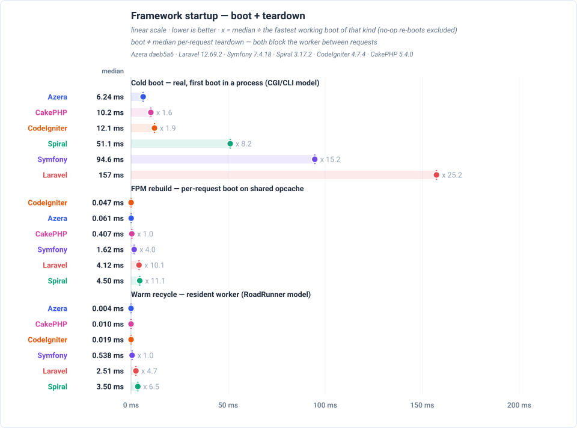

## Total response times

Total time to serve one pass over every benchmarked endpoint — each framework's sum of its endpoint medians, not a single response time — drawn relative to the baseline, so a row states how many times the baseline's own total it needed. Each endpoint's median is boot-inclusive occupancy for this view's deployment model, so the total is the worker time one pass over every endpoint costs. The chart orders the frameworks by that total and prints each one's multiplier beside its row.

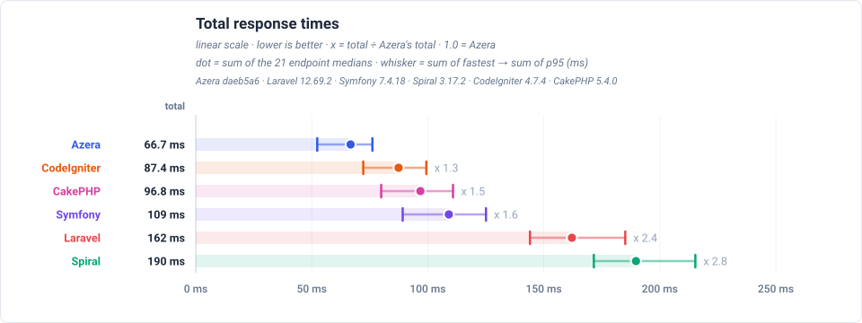

## Feature benchmarks

One race per framework feature, each run as a real request against a real database. Each feature states the request it measures under its own heading. Every figure — the winner of each race and the margin over the runner-up — is in that feature's own chart below, which anchors each endpoint at its fastest framework.

### Routing
 `GET /api/routing/1` — matches a typed route and dispatches it to a constant handler — no template and no database access — so the band measures route matching and dispatch and nothing else. The endpoint sits in a deep bucket of the route table, which is where a compiled index actually saves work. `/echo` is drawn beside it: the same constant handler behind a STATIC route, i.e. the floor that route matching is measured against — and, like any floor, it is mostly the SERVER rather than the framework. Measured 2026-11-24 with `temp/echo-ab.php` on the bench VM, the entire framework layer on `/echo` costs single-digit microseconds, inside rows that print two to three orders of magnitude more. A difference of a few microseconds there is below the run-to-run spread, so read `/echo` as the common floor and NOT as a comparison between entrants; the charts that separate frameworks are the ones with real work in them.

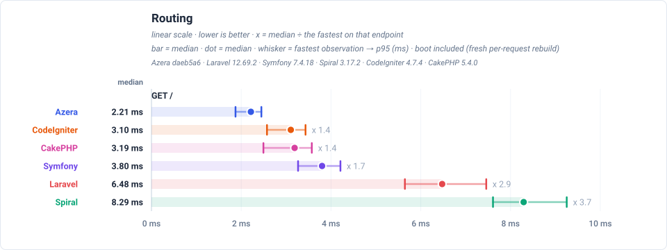

### ORM / Active Record
 `GET /items` — loads one page of the 1,000 seeded rows through each framework's ORM / Active Record layer: 20 items plus a COUNT for the pagination total. The `-fast` band repeats that page with hydration switched off, so the cost of building one object per row can be read directly instead of inferred.

### Query Builder
 `GET /items-qb` — builds the same page of 20 items with each framework's query builder instead of its ORM, so the two data-access styles can be compared directly.

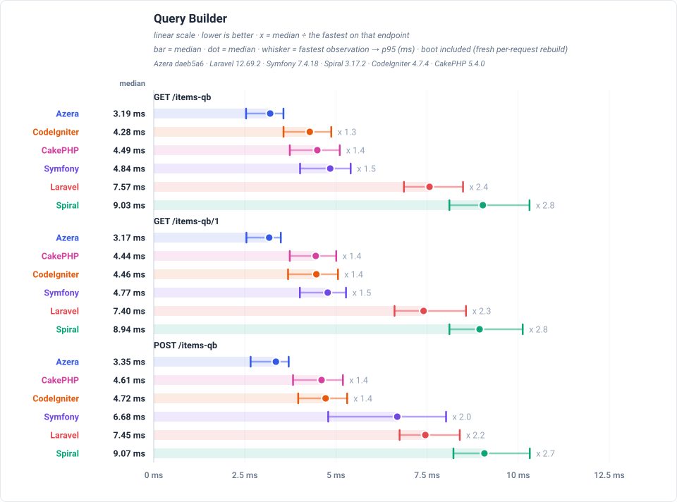

### REST API (JSON)
 `GET /api/items` — serves the same page of items as a JSON response rather than HTML, which adds serialization to the ORM work. The `-fast` band repeats that response with hydration switched off, so serialization cost and hydration cost can be told apart.

### AOP (Aspect-Oriented)
 `GET /features/aop` — runs a request through interceptor machinery — logging, retry and transaction advice wrapped around the handler. The entrants split into two styles, and this row means different work on each side. TRANSPARENT interception — advice declared on the method and applied by generated code, handler body untouched — is what Azera does (`#[Advised]`, `#[Transactional]`, `#[Cache]`, `#[Log]`, `#[Retry]`). DIRECT interception — the pipeline written out in the code — is what everyone else does: Laravel composes an Illuminate Pipeline and Symfony chains invokable interceptor classes, both documenting that they have no proxy-based AOP; Spiral builds a `PipelineBuilder` pipeline; CodeIgniter, CakePHP and Phalcon have no interceptor layer at all and write the transactional insert by hand. Do NOT read the ranking across styles as a speed verdict: the two sides pay for different machinery, and the same caution applies to `cache`, `log` and `retry`, which on Azera also route through generated proxies while every other entrant implements them plainly. `GET /features/aop-direct` is the control: the identical insert with the transaction written by hand, served by every entrant, so the pair prices the abstraction on the same work. Phalcon sits the aop race out; it competes in logging, retry and pipeline.

*Read this row in two styles.* **transparent** (advice declared on the method, applied by generated code): Azera. **direct** (the pipeline is written out in the code): Laravel, Symfony, Spiral, CodeIgniter, CakePHP. The two styles pay for different machinery, and the cross-style ranking is not a speed verdict.

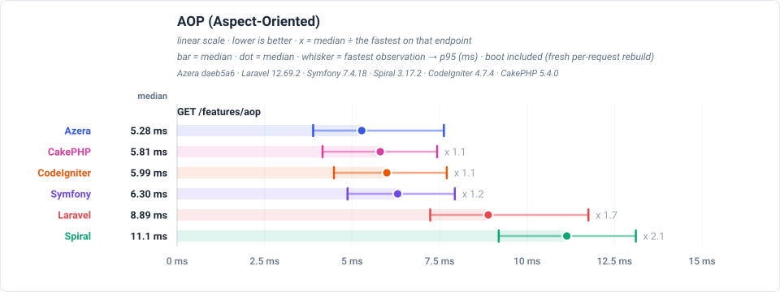

### Logging
 `GET /features/log` — logs a method entry and exit through the framework's own logger — PSR-3 everywhere. On Azera the call goes through a generated `#[Log]` proxy, so this row includes interception cost the other entrants do not pay here.

### Retry
 `GET /features/retry` — runs a deliberately flaky operation through a retry policy of up to three attempts — an explicit loop or interceptor everywhere, and on Azera a generated `#[Retry]` proxy, so this row includes interception cost the others do not pay here.

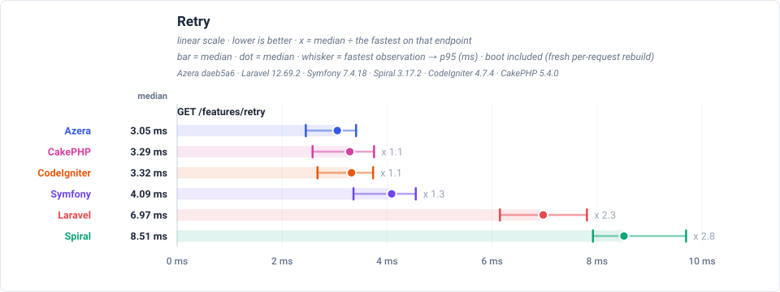

### Pipeline (explicit)
 `GET /features/pipeline` — composes the handler with explicit interceptor steps — no proxy generation, so this row separates "the pipeline mechanism" from "the advice declaration mechanism".

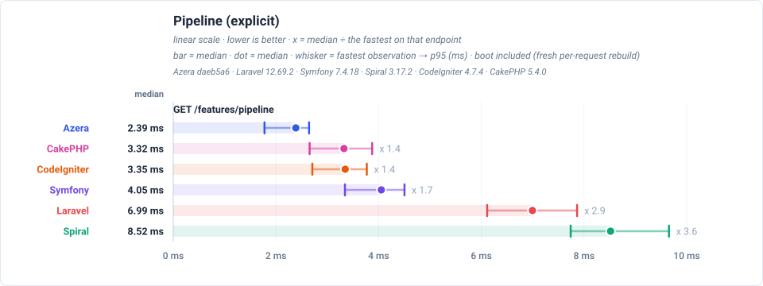

### Cache
 `GET /features/cache` — reads a COUNT(*) over the 1,000 rows through the framework's cache with a 10-second TTL, so a hit costs no database work and a miss runs the query. On Azera the read goes through a generated `#[Cache]` proxy, so this row includes interception cost the other entrants do not pay here.

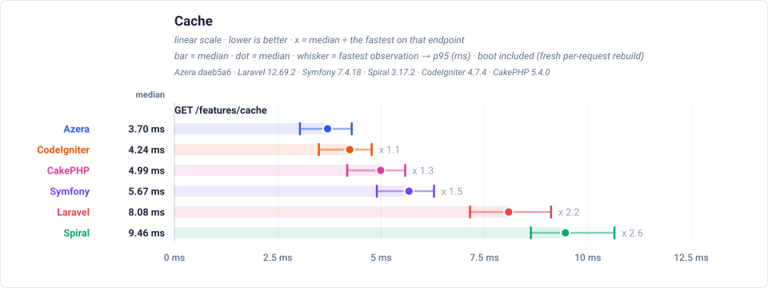

### Database Events
 `GET /features/db-events` — inserts one event row per request and lets the framework's database events fire around that write. On Azera the insert goes through a generated `#[Transactional]` proxy, so this row includes interception cost the other entrants do not pay here.

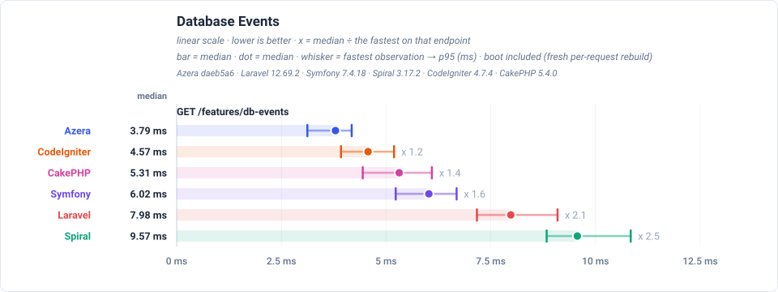

### Event Dispatcher
 `GET /features/events` — dispatches an in-process event to registered listeners. On Azera the item it writes goes through a generated `#[Transactional]` proxy, so this row includes interception cost the other entrants do not pay here.

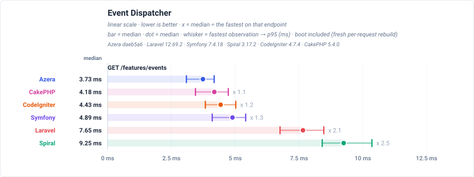

### Validation
 `GET /features/validation` — validates a payload with the framework's own validator.

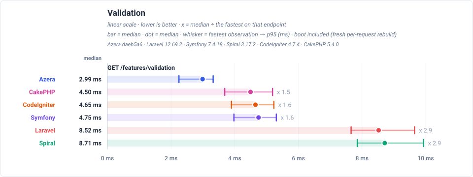

### Config
 `GET /features/config` — resolves a value from the framework's config repository.

### Request-Scoped Services
 `GET /features/request-scoped` — resolves a service scoped to the request from the container.

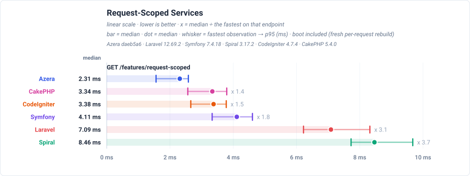

### Rate Limiter
 `GET /features/rate-limit` — checks a cache-backed rate limiter, which has long since denied the caller.

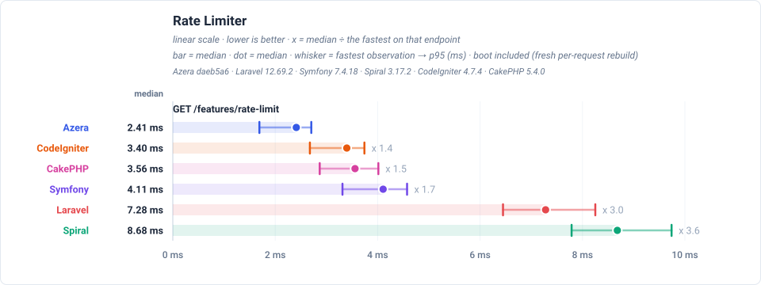

## Latency by endpoint

Median in milliseconds, lower is better. **Bold** = fastest for that endpoint; a trailing `≈` = within the run-to-run noise band of the fastest, so read it as a tie rather than a defeat (`Tables::TIE_BAND` states the band and how it was calibrated). The median is the statistic the charts beside this table draw, so a cell and its bar are the same number; the dataset also carries a trimmed mean, which sits a few percent higher and ranks identically in all but two dead-heat cells, and it stays available for the outlier-robust cross-check rather than as a second published figure. Every number is END-TO-END per-request occupancy for the view's deployment model: the framework boot of that model is part of the cell, not parked in a separate chart. The workload column states what each request reads or writes. Every framework runs the same seeded database and the same page size, so the payload is identical no matter which framework served it; the workload column is the part of the suite that varies.

Each cell also shows the request's lifecycle split as `total boot + handle + cleanup` — the terms sum to the headline. Cleanup is the post-response teardown a worker performs between requests (terminate() finalizers, request-scoped resets); handle is the dispatch itself; boot is the framework startup that request waits for in this deployment model.

This dataset times cold requests END-TO-END: every iteration pays a fresh framework boot inside the request clock, exactly like a real PHP-FPM worker building the app before serving. The boot share is therefore inside both the headline and the `boot` term of the sub-line — the totals here are the numbers a user waits for.

| Request | Workload | Azera | Laravel | Symfony | Spiral | CodeIgniter | CakePHP |
|---|---|---:|---:|---:|---:|---:|---:|
| `GET /api/routing/1` | no DB — typed route + constant body (routing only) | — | — | — | — | — | — |
| `GET /` | no DB — routing + template only | **2.21 0.06+2.15+0.00** | 6.48 4.08+2.40+0.00 | 3.80 1.63+2.17+0.00 | 8.29 4.55+3.72+0.02 | 3.10 0.02+3.06+0.02 | 3.19 0.38+2.81+0.00 |
| `GET /echo` | no DB — static route, constant body (throughput floor) | — | — | — | — | — | — |
| `GET /items` | 20 of 1000 items (page 1, + COUNT) | **3.50 0.06+3.43+0.01** | 7.97 3.96+4.01+0.00 | 6.29 1.64+4.65+0.00 | 9.64 4.50+5.11+0.03 | 4.32 0.03+4.27+0.02 | 5.94 0.40+5.54+0.00 |
| `GET /items-fast` | 20 of 1000 items (page 1, + COUNT), hydrated rows not built | — | — | — | — | — | — |
| `GET /items/1` | 1 item by id | **3.19 0.05+3.13+0.01** | 7.72 4.00+3.72+0.00 | 5.35 1.60+3.75+0.00 | 9.33 4.45+4.86+0.02 | 4.46 0.03+4.41+0.02 | 5.71 0.40+5.31+0.00 |
| `POST /items` | 1 row upserted (sentinel #999999) | **3.60 0.05+3.54+0.01** | 7.75 3.99+3.76+0.00 | 7.19 1.66+5.52+0.01 | 9.45 4.48+4.95+0.02 | 4.58 0.03+4.53+0.02 | 5.91 0.40+5.51+0.00 |
| `GET /items-qb` | 20 of 1000 items (page 1, + COUNT) | **3.19 0.06+3.13+0.00** | 7.57 4.07+3.50+0.00 | 4.84 1.62+3.22+0.00 | 9.03 4.52+4.49+0.02 | 4.28 0.03+4.23+0.02 | 4.49 0.40+4.09+0.00 |
| `GET /items-qb/1` | 1 item by id | **3.17 0.05+3.12+0.00** | 7.40 4.02+3.38+0.00 | 4.77 1.60+3.17+0.00 | 8.94 4.50+4.42+0.02 | 4.46 0.03+4.41+0.02 | 4.44 0.39+4.05+0.00 |
| `POST /items-qb` | 1 row upserted (sentinel #999997) | **3.35 0.06+3.29+0.00** | 7.45 4.05+3.40+0.00 | 6.68 1.63+5.05+0.00 | 9.07 4.52+4.53+0.02 | 4.72 0.03+4.67+0.02 | 4.61 0.40+4.21+0.00 |
| `GET /api/items` | 20 of 1000 items as JSON | **3.16 0.06+3.10+0.00** | 9.27 4.12+5.15+0.00 | 5.76 1.61+4.15+0.00 | 8.93 4.48+4.42+0.03 | 4.29 0.03+4.24+0.02 | 5.75 0.41+5.34+0.00 |
| `GET /api/items-fast` | 20 of 1000 items as JSON, rows not hydrated | — | — | — | — | — | — |
| `GET /api/items/1` | 1 item by id as JSON | **3.14 0.06+3.07+0.01** | 9.15 4.12+5.03+0.00 | 5.37 1.63+3.74+0.00 | 8.83 4.38+4.43+0.02 | 4.46 0.03+4.41+0.02 | 5.86 0.42+5.44+0.00 |
| `POST /api/items` | 1 row upserted (sentinel #999998) | **3.23 0.06+3.16+0.01** | 7.86 3.99+3.87+0.00 | 6.89 1.65+5.23+0.01 | 8.86 4.46+4.38+0.02 | 4.61 0.03+4.56+0.02 | 5.92 0.41+5.51+0.00 |
| `GET /features/aop` | 1 row upserted (sentinel #888800) | **5.28 0.06+5.22+0.00** | 8.89 4.19+4.70+0.00 | 6.30 1.62+4.67+0.01 | 11.1 4.5+6.6+0.0 | 5.99 0.03+5.94+0.02 | 5.81 0.41+5.40+0.00 |
| `GET /features/aop-direct` | 1 row upserted (sentinel #888800) | — | — | — | — | — | — |
| `GET /features/cache` | COUNT(*) of 1000 rows, cached 10s (miss = query) | **3.70 0.05+3.65+0.00** | 8.08 4.05+4.03+0.00 | 5.67 1.60+4.07+0.00 | 9.46 4.50+4.94+0.02 | 4.24 0.03+4.19+0.02 | 4.99 0.39+4.60+0.00 |
| `GET /features/log` | no DB — buffered log handlers | **3.08 0.05+3.03+0.00** | 6.94 4.01+2.93+0.00 | 4.08 1.64+2.44+0.00 | 8.55 4.34+4.19+0.02 | 3.38 0.03+3.33+0.02 | 3.33 0.39+2.94+0.00 |
| `GET /features/retry` | no DB — retry policy | **3.05 0.06+2.99+0.00** | 6.97 4.01+2.96+0.00 | 4.09 1.61+2.48+0.00 | 8.51 4.31+4.18+0.02 | 3.32 0.03+3.27+0.02 | 3.29 0.39+2.90+0.00 |
| `GET /features/pipeline` | no DB — middleware pipeline | **2.39 0.06+2.33+0.00** | 6.99 4.00+2.99+0.00 | 4.05 1.61+2.44+0.00 | 8.52 4.32+4.18+0.02 | 3.35 0.03+3.30+0.02 | 3.32 0.40+2.92+0.00 |
| `GET /features/db-events` | 1 row upserted (sentinel #888800) + COUNT(*), events collected | **3.79 0.05+3.74+0.00** | 7.98 3.99+3.99+0.00 | 6.02 1.62+4.39+0.01 | 9.57 4.47+5.08+0.02 | 4.57 0.03+4.52+0.02 | 5.31 0.41+4.90+0.00 |
| `GET /features/events` | no DB — in-process listeners | **3.73 0.06+3.67+0.00** | 7.65 4.02+3.63+0.00 | 4.89 1.61+3.28+0.00 | 9.25 4.46+4.77+0.02 | 4.43 0.03+4.38+0.02 | 4.18 0.40+3.78+0.00 |
| `GET /features/validation` | no DB — validator run | **2.99 0.06+2.93+0.00** | 8.52 4.14+4.38+0.00 | 4.75 1.61+3.14+0.00 | 8.71 4.32+4.37+0.02 | 4.65 0.03+4.60+0.02 | 4.50 0.40+4.10+0.00 |
| `GET /features/config` | no DB — config lookup | **2.26 0.06+2.20+0.00** | 7.10 4.08+3.02+0.00 | 4.08 1.61+2.47+0.00 | 8.50 4.32+4.16+0.02 | 3.43 0.03+3.38+0.02 | 3.38 0.40+2.98+0.00 |
| `GET /features/request-scoped` | no DB — scoped service resolve | **2.31 0.06+2.25+0.00** | 7.09 4.07+3.02+0.00 | 4.11 1.62+2.49+0.00 | 8.46 4.28+4.16+0.02 | 3.38 0.03+3.33+0.02 | 3.34 0.40+2.94+0.00 |
| `GET /features/rate-limit` | no DB — cache-backed limiter | **2.41 0.07+2.34+0.00** | 7.28 4.02+3.26+0.00 | 4.11 1.62+2.49+0.00 | 8.68 4.30+4.36+0.02 | 3.40 0.03+3.35+0.02 | 3.56 0.41+3.15+0.00 |

---

> **Auto-generated.** This page and its charts are produced by the `azera-competition` repository:
> `php run.php --apps=azera,laravel,symfony,spiral,codeigniter,cakephp --warm --cold --seed --out=results/free-for-all-opcache-iso`
> then `php scripts/derive-fpm.php results/free-for-all-opcache-iso` and `php scripts/report.php`. Do not edit by hand — re-run the benchmark to update it.

Every chart is a plain SVG generated from the result JSON, so the numbers and the diagrams can never disagree.
