# Framework Competition — Real PHP-FPM

Real nginx + PHP-FPM serving over HTTP: the framework boots for every request, which is what PHP actually runs in production. The pool's worker-recycling setting is stated with the server floor below, since it changes what each row contains. End-to-end HTTP over loopback — includes the constant webserver overhead (see floor-http/floor-php in the dataset). Single sequential client.

**Environment** — PHP 8.5.11 · Linux 6.8.0-139-generic · OPcache: yes · JIT: tracing (buffer 64M) · 1000 iterations per run over 10 runs, lower is better.

**Frameworks** — Azera v0.6.0 · Laravel 12.69.2 · Symfony 7.4.18 · Spiral 3.17.2 · CodeIgniter 4.7.4 · CakePHP 5.4.0 · Phalcon 6 (RC) 6.0.0RC4.

_Measured 2026-11-24T18:27:42+00:00_

## Framework startup

Time from PHP start until the framework is ready to serve, measured inside the FPM entry script — the boot every request waits for on this deployment, because nginx/PHP-FPM re-runs the entry script per request.

- Each app boots through a **pruned autoloader** (`vendor/app-autoload/<app>/autoload.php`). This repository has ONE composer.json, so the shared `vendor/autoload.php` runs composer's EAGER `files` list for all seven frameworks on every request: the bootstrap code of entrants the app never instantiates. The pruned loader is the same ClassLoader with the same PSR-4 and classmap tables, restricted to the app's own dependency closure (see `scripts/app-autoload.php`). What it removes is a fixed per-request cost, so it dominates a lean framework's boot and is invisible against a slow one — read this band as framework work, not as composer work.
- The fastest and slowest framework on this band are named by the chart below; the multiplier beside each row states how many times the fastest boot it needed.
- Azera re-run the entry script but had nothing left to build. They are left out of the chart's factor column.
- Each framework's boot is reduced to one statistic (median of the probe samples), and the samples per framework are recorded in the dataset.

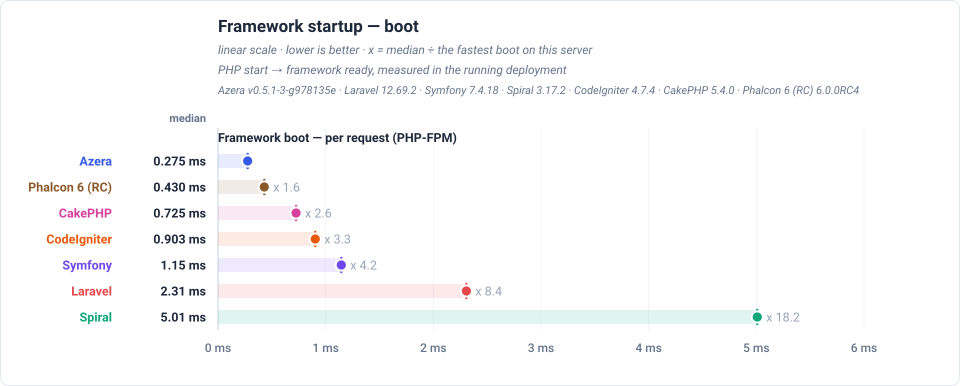

## Total response times

Total time to serve one pass over every benchmarked endpoint — each framework's sum of its endpoint medians, not a single response time — drawn relative to the baseline, so a row states how many times the baseline's own total it needed. Each endpoint's median is boot-inclusive occupancy for this view's deployment model, so the total is the worker time one pass over every endpoint costs. The chart orders the frameworks by that total and prints each one's multiplier beside its row.

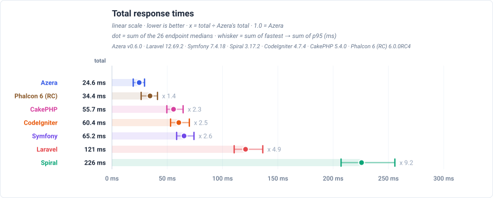

## Feature benchmarks

One race per framework feature, each run as a real request against a real database. Each feature states the request it measures under its own heading. Every figure — the winner of each race and the margin over the runner-up — is in that feature's own chart below, which anchors each endpoint at its fastest framework.

### Routing
 `GET /api/routing/1` — matches a typed route and dispatches it to a constant handler — no template and no database access — so the band measures route matching and dispatch and nothing else. The endpoint sits in a deep bucket of the route table, which is where a compiled index actually saves work. `/echo` is drawn beside it: the same constant handler behind a STATIC route, i.e. the floor that route matching is measured against — and, like any floor, it is mostly the SERVER rather than the framework. Measured 2026-11-24 with `temp/echo-ab.php` on the bench VM, the entire framework layer on `/echo` costs single-digit microseconds, inside rows that print two to three orders of magnitude more. A difference of a few microseconds there is below the run-to-run spread, so read `/echo` as the common floor and NOT as a comparison between entrants; the charts that separate frameworks are the ones with real work in them.

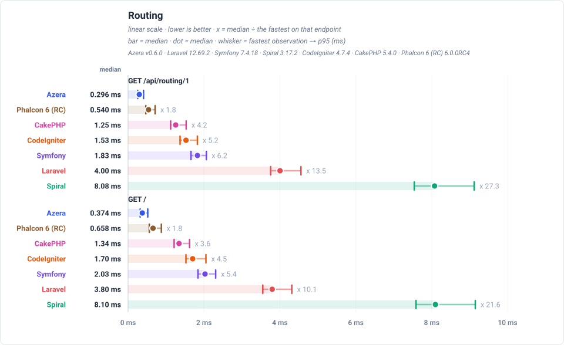

### ORM / Active Record
 `GET /items` — loads one page of the 1,000 seeded rows through each framework's ORM / Active Record layer: 20 items plus a COUNT for the pagination total. The `-fast` band repeats that page with hydration switched off, so the cost of building one object per row can be read directly instead of inferred.

### Query Builder
 `GET /items-qb` — builds the same page of 20 items with each framework's query builder instead of its ORM, so the two data-access styles can be compared directly.

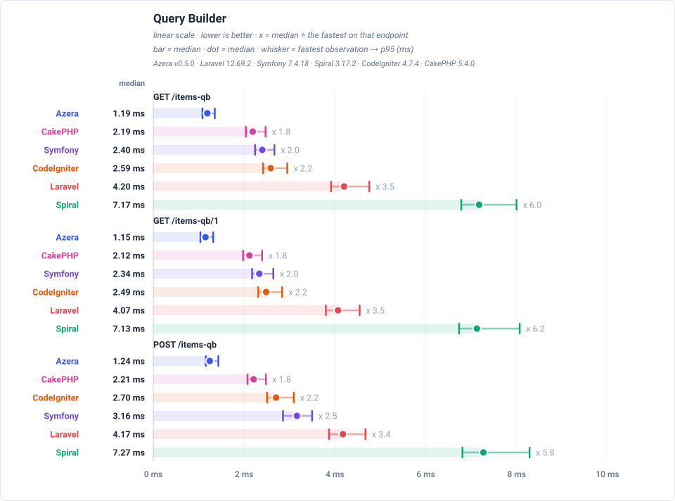

### REST API (JSON)
 `GET /api/items` — serves the same page of items as a JSON response rather than HTML, which adds serialization to the ORM work. The `-fast` band repeats that response with hydration switched off, so serialization cost and hydration cost can be told apart.

### AOP (Aspect-Oriented)
 `GET /features/aop` — runs a request through interceptor machinery — logging, retry and transaction advice wrapped around the handler. The entrants split into two styles, and this row means different work on each side. TRANSPARENT interception — advice declared on the method and applied by generated code, handler body untouched — is what Azera does (`#[Advised]`, `#[Transactional]`, `#[Cache]`, `#[Log]`, `#[Retry]`). DIRECT interception — the pipeline written out in the code — is what everyone else does: Laravel composes an Illuminate Pipeline and Symfony chains invokable interceptor classes, both documenting that they have no proxy-based AOP; Spiral builds a `PipelineBuilder` pipeline; CodeIgniter, CakePHP and Phalcon have no interceptor layer at all and write the transactional insert by hand. Do NOT read the ranking across styles as a speed verdict: the two sides pay for different machinery, and the same caution applies to `cache`, `log` and `retry`, which on Azera also route through generated proxies while every other entrant implements them plainly. `GET /features/aop-direct` is the control: the identical insert with the transaction written by hand, served by every entrant, so the pair prices the abstraction on the same work. Phalcon sits the aop race out; it competes in logging, retry and pipeline.

*Not measured here:* Phalcon 6 (RC) — Phalcon 6 (RC) has no interceptor layer (no attribute-declared, proxy-generated advice), so this race would compare its hand-written transaction against the other entrants' generated proxies — the machinery, not the framework. It serves `GET /features/aop` and the three advice demos, so a missing row is a deliberate exclusion, not an unimplemented endpoint.

*Read this row in two styles.* **transparent** (advice declared on the method, applied by generated code): Azera. **direct** (the pipeline is written out in the code): Laravel, Symfony, Spiral, CodeIgniter, CakePHP. The two styles pay for different machinery, and the cross-style ranking is not a speed verdict. `GET /features/aop-direct` is the control — the identical insert with the transaction written by hand — so the gap between that row and this one is what interception actually costs.

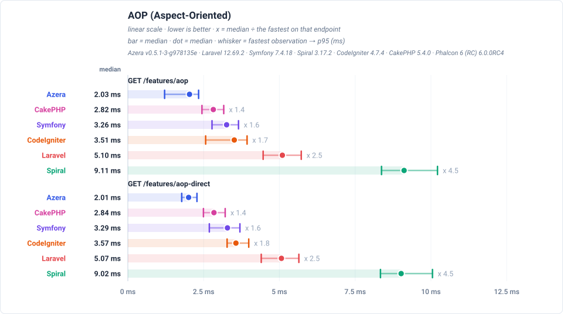

### Logging
 `GET /features/log` — logs a method entry and exit through the framework's own logger — PSR-3 everywhere. On Azera the call goes through a generated `#[Log]` proxy, so this row includes interception cost the other entrants do not pay here.

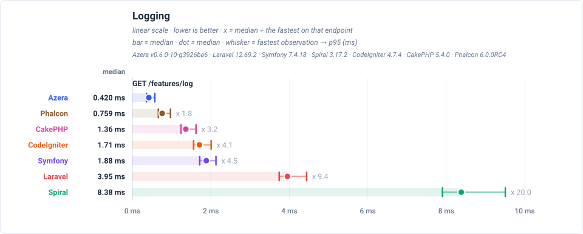

### Retry
 `GET /features/retry` — runs a deliberately flaky operation through a retry policy of up to three attempts — an explicit loop or interceptor everywhere, and on Azera a generated `#[Retry]` proxy, so this row includes interception cost the others do not pay here.

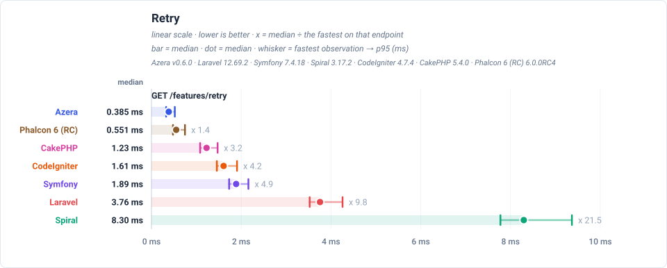

### Pipeline (explicit)
 `GET /features/pipeline` — composes the handler with explicit interceptor steps — no proxy generation, so this row separates "the pipeline mechanism" from "the advice declaration mechanism".

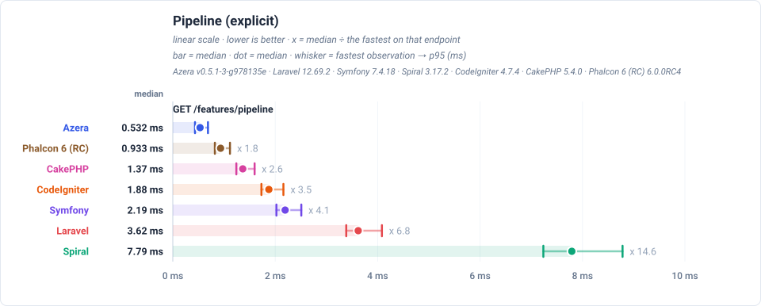

### Cache
 `GET /features/cache` — reads a COUNT(*) over the 1,000 rows through the framework's cache with a 10-second TTL, so a hit costs no database work and a miss runs the query. On Azera the read goes through a generated `#[Cache]` proxy, so this row includes interception cost the other entrants do not pay here.

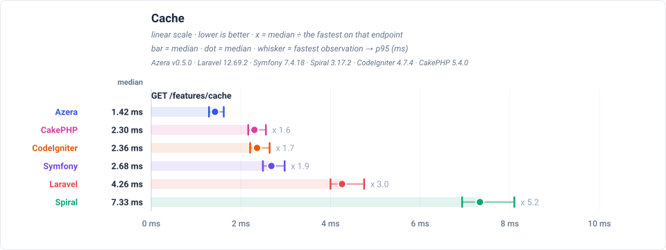

### Database Events
 `GET /features/db-events` — inserts one event row per request and lets the framework's database events fire around that write. On Azera the insert goes through a generated `#[Transactional]` proxy, so this row includes interception cost the other entrants do not pay here.

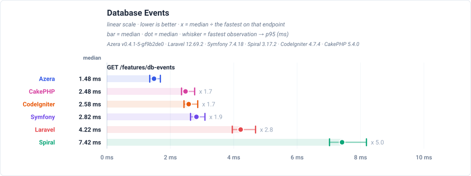

### Event Dispatcher
 `GET /features/events` — dispatches an in-process event to registered listeners. On Azera the item it writes goes through a generated `#[Transactional]` proxy, so this row includes interception cost the other entrants do not pay here.

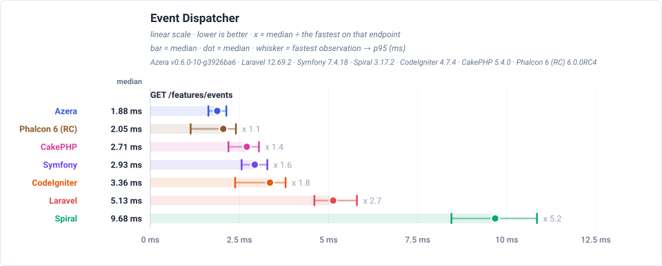

### Validation
 `GET /features/validation` — validates a payload with the framework's own validator.

### Config
 `GET /features/config` — resolves a value from the framework's config repository.

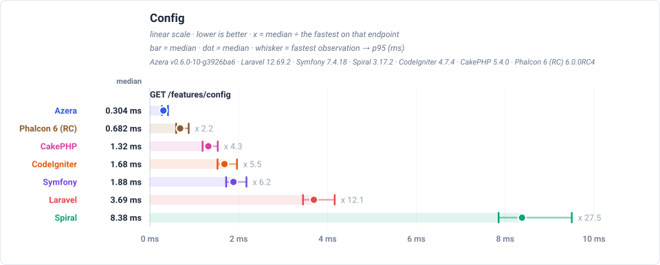

### Request-Scoped Services
 `GET /features/request-scoped` — resolves a service scoped to the request from the container.

### Rate Limiter
 `GET /features/rate-limit` — checks a cache-backed rate limiter, which has long since denied the caller.

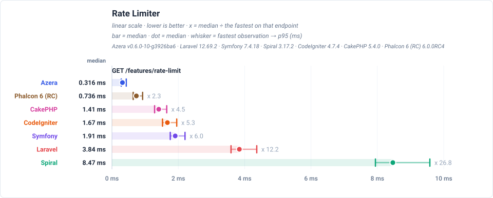

## Per-request memory

How much memory a single request needs, for every framework, measured inside the FPM worker that served it. The numbers come from the FPM worker process itself: because the entry script is torn down when the request ends, it appends one sample as it exits, and the harness reads that back. The pool is `pm = static` with `max_children = 1` and `max_requests = 0`, so this is ONE worker that stays alive for the whole block — which is why it has retained memory worth reporting at all.

A request's high-water mark is taken from the framework-ready boundary of the entry script to the moment the response is finished, with the mark reset at that boundary — so it counts exactly what serving the request cost, and never bleeds into the next one. Each endpoint was probed once, so the range shows how much the endpoints themselves differ — a property of the workload rather than of the measurement.

All six frameworks are drawn on one shared MB axis. The **left cap** is the lightest probed endpoint, the **dot** is the median endpoint, and the **right cap** is the heaviest. Every mark is a measured endpoint rather than an interpolation, so each can be named — the three numbers printed beside each bar are those same three readings. The faint bar behind each mark runs from zero to the median, so a row's length is read against the axis rather than estimated from the caps. The multiplier beside a row divides its median by the lightest median on the page; the reference row carries none.

Rows are ordered by the **median** request — a framework's typical cost — so one heavy route cannot reorder the table on its own. A row that stays flat and a row that reaches far right therefore say different things: the first is cheap on every route, the second is cheap on a typical request until one heavy route sets the worst case a pool has to be sized for.

## Latency by endpoint

Trimmed mean in milliseconds, lower is better. **Bold** = fastest for that endpoint. Every number is END-TO-END per-request occupancy for the view's deployment model: the framework boot of that model is part of the cell, not parked in a separate chart. These are REAL deployments measured over HTTP: every row carries the constant server cost, which is why the values cluster — the floor note below states what stands under them. The workload column states what each request reads or writes. Every framework runs the same seeded database and the same page size, so the payload is identical no matter which framework served it; the workload column is the part of the suite that varies.

**Server floor** — measured nginx + PHP-FPM with `pm.max_requests=0`: the pool never recycles its worker, so no process is spawned per request — what remains is the FastCGI handshake plus a minimal script. A hello-world endpoint that boots nothing but PHP (`floor-php`) and a static file through nginx (`floor-http`) measure exactly that cost — the floor every row below stands on. Subtracting that floor leaves the framework's own per-request boot, which FPM still pays for every request even though its worker survives.

| Request | Workload | Azera | Laravel | Symfony | Spiral | CodeIgniter | CakePHP | Phalcon 6 (RC) |
|---|---|---:|---:|---:|---:|---:|---:|---:|
| `GET /api/routing/1` | no DB — typed route + constant body (routing only) | **0.311** | 4.07 | 1.86 | 8.20 | 1.56 | 1.29 | 0.562 |
| `GET /` | no DB — routing + template only | **0.394** | 3.86 | 2.06 | 8.22 | 1.74 | 1.38 | 0.681 |
| `GET /echo` | no DB — static route, constant body (throughput floor) | **0.264** | 3.72 | 1.79 | 8.14 | 1.58 | 1.25 | 0.569 |
| `GET /items` | 20 of 1000 items (page 1, + COUNT) | **1.18** | 5.33 | 3.29 | 8.97 | 2.59 | 2.74 | 1.90 |
| `GET /items-fast` | 20 of 1000 items (page 1, + COUNT), hydrated rows not built | **1.05** | 5.04 | 3.21 | 8.85 | 2.47 | 2.67 | 1.84 |
| `GET /items/1` | 1 item by id | **1.06** | 4.97 | 2.66 | 8.84 | 2.39 | 2.54 | 1.60 |
| `POST /items` | 1 row upserted (sentinel #999999) | **2.13** | 6.19 | 3.66 | 10.4 | 3.48 | 3.62 | 2.67 |
| `GET /items-qb` | 20 of 1000 items (page 1, + COUNT) | **0.982** | 4.88 | 2.32 | 8.63 | 2.44 | 2.15 | 1.27 |
| `GET /items-qb/1` | 1 item by id | **0.938** | 4.69 | 2.27 | 8.63 | 2.34 | 2.09 | 1.16 |
| `POST /items-qb` | 1 row upserted (sentinel #999997) | **1.90** | 5.78 | 3.25 | 9.87 | 3.43 | 3.11 | 2.17 |
| `GET /api/items` | 20 of 1000 items as JSON | **0.963** | 5.10 | 2.63 | 8.19 | 2.36 | 2.41 | 1.55 |
| `GET /api/items-fast` | 20 of 1000 items as JSON, rows not hydrated | **0.884** | 4.77 | 2.56 | 8.04 | 2.26 | 2.35 | 1.57 |
| `GET /api/items/1` | 1 item by id as JSON | **0.935** | 4.93 | 2.38 | 8.12 | 2.28 | 2.38 | 1.50 |
| `POST /api/items` | 1 row upserted (sentinel #999998) | **1.85** | 5.65 | 3.38 | 9.35 | 3.23 | 3.48 | 2.55 |
| `GET /features/aop` | 1 row upserted (sentinel #888800) | **1.81** | 5.26 | 2.97 | 9.81 | 3.25 | 2.73 | — |
| `GET /features/aop-direct` | 1 row upserted (sentinel #888800) | **1.79** | 5.27 | 2.98 | 9.70 | 3.25 | 2.73 | — |
| `GET /features/cache` | COUNT(*) of 1000 rows, cached 10s (miss = query) | **0.872** | 4.59 | 2.59 | 8.76 | 2.25 | 2.27 | 1.15 |
| `GET /features/log` | no DB — buffered log handlers | **0.396** | 3.79 | 1.91 | 8.45 | 1.66 | 1.28 | 0.672 |
| `GET /features/retry` | no DB — retry policy | **0.403** | 3.82 | 1.92 | 8.42 | 1.64 | 1.26 | 0.576 |
| `GET /features/pipeline` | no DB — middleware pipeline | **0.304** | 3.81 | 1.92 | 8.41 | 1.66 | 1.28 | 0.692 |
| `GET /features/db-events` | 1 row upserted (sentinel #888800) + COUNT(*), events collected | **1.85** | 5.63 | 3.72 | 9.97 | 3.45 | 3.45 | 2.02 |
| `GET /features/events` | no DB — in-process listeners | **1.77** | 5.29 | 3.02 | 9.66 | 3.35 | 2.75 | 2.00 |
| `GET /features/validation` | no DB — validator run | **0.304** | 4.72 | 2.24 | 8.49 | 2.00 | 1.68 | 0.741 |
| `GET /features/config` | no DB — config lookup | **0.270** | 3.80 | 1.90 | 8.35 | 1.66 | 1.26 | 0.623 |
| `GET /features/request-scoped` | no DB — scoped service resolve | **0.278** | 3.78 | 1.89 | 8.38 | 1.64 | 1.26 | 0.579 |
| `GET /features/rate-limit` | no DB — cache-backed limiter | **0.286** | 3.95 | 1.94 | 8.47 | 1.65 | 1.37 | 0.656 |

---

> **Auto-generated.** This page and its charts are produced by the `azera-competition` repository:
> `php run.php --apps=azera,laravel,symfony,spiral,codeigniter,cakephp --warm --cold --seed --out=results/free-for-all-opcache-iso`
> then `php scripts/derive-fpm.php results/free-for-all-opcache-iso` and `php scripts/report.php`. Do not edit by hand — re-run the benchmark to update it.

Every chart is a plain SVG generated from the result JSON, so the numbers and the diagrams can never disagree.
