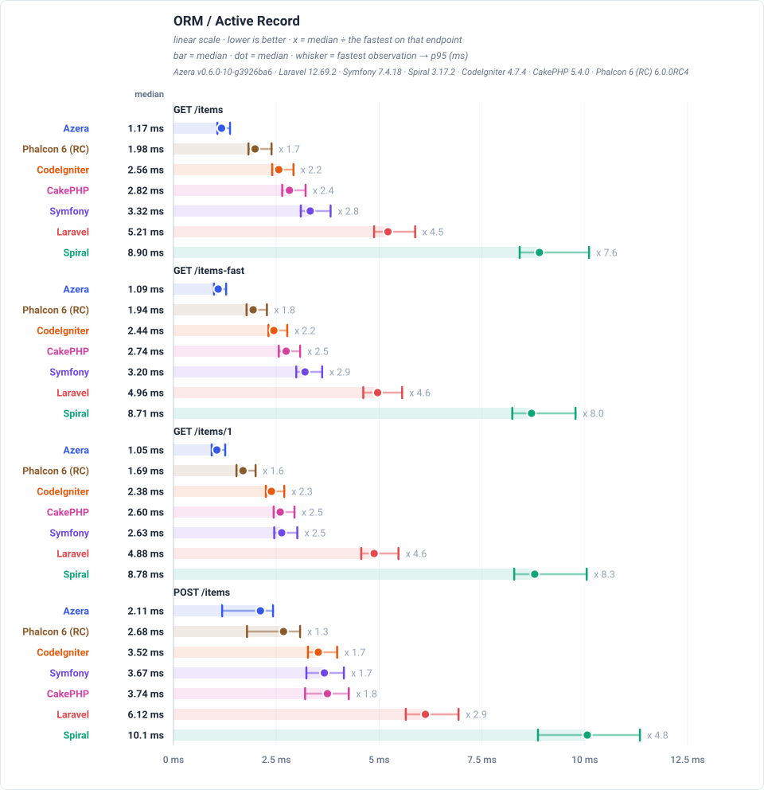
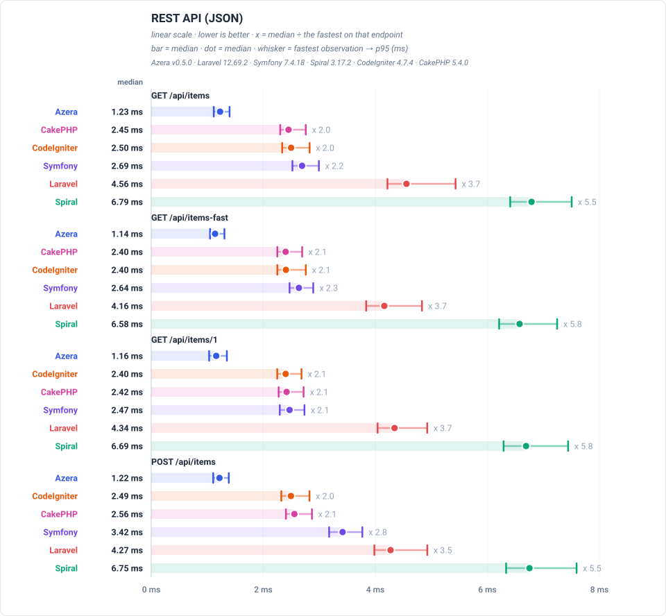
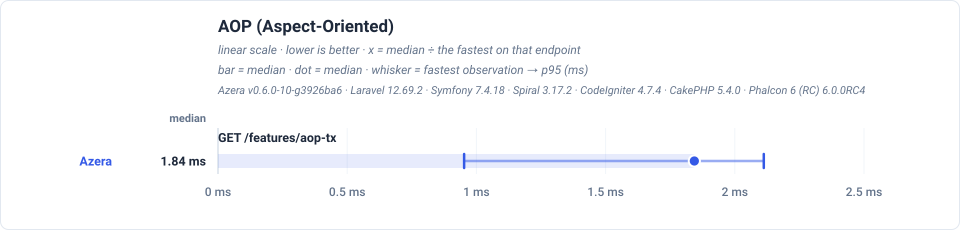
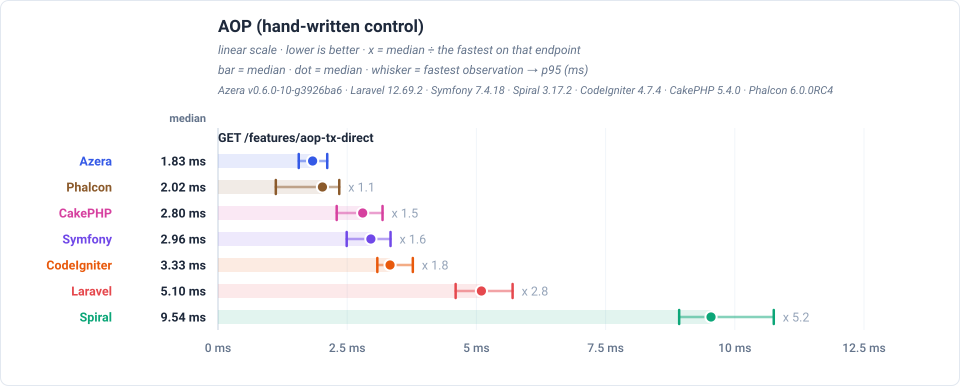
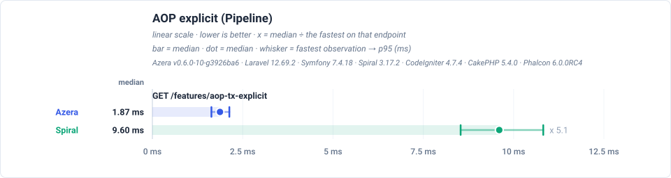
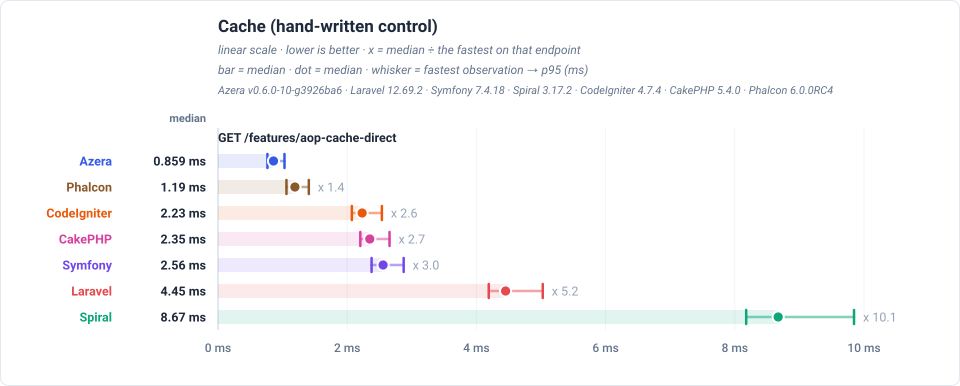
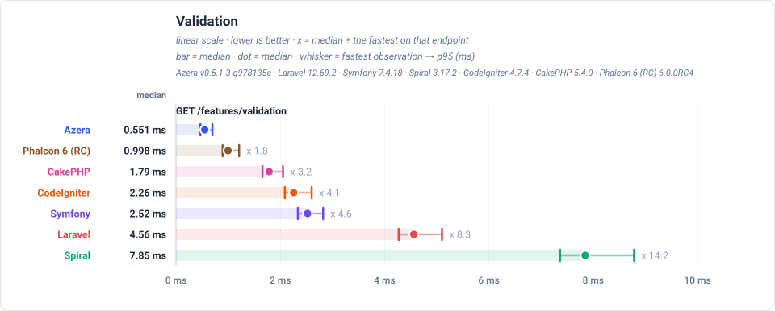
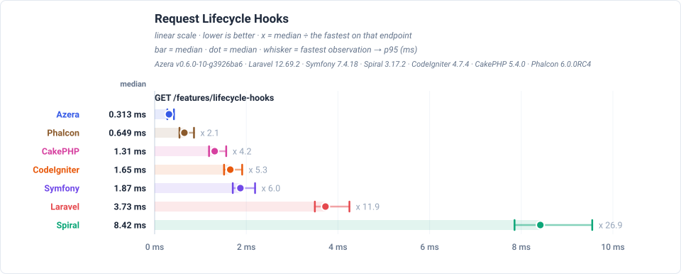
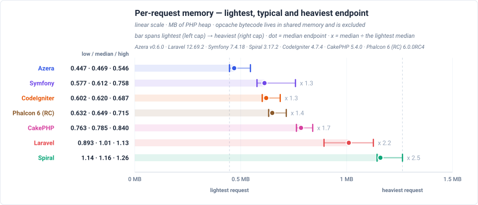

# Framework Competition — Real PHP-FPM

Real nginx + PHP-FPM serving over HTTP: the framework boots for every request, which is what PHP actually runs in production. The pool's worker-recycling setting is stated with the server floor below, since it changes what each row contains. End-to-end HTTP over loopback — includes the constant webserver overhead (see floor-http/floor-php in the dataset). Single sequential client.

**Environment** — PHP 8.5.11 · Linux 6.8.0-139-generic · OPcache: yes · JIT: tracing (buffer 64M) · 1000 iterations per run over 10 runs, lower is better.

**Frameworks** — Azera v0.6.0-10-g3926ba6 · Laravel 12.69.2 · Symfony 7.4.18 · Spiral 3.17.2 · CodeIgniter 4.7.4 · CakePHP 5.4.0 · Phalcon 6.0.0RC4.

_Measured 2026-11-26T01:57:45+00:00_

## Framework startup

Time from PHP start until the framework is ready to serve, measured inside the FPM entry script — the boot every request waits for on this deployment, because nginx/PHP-FPM re-runs the entry script per request.

- Each app boots through a **pruned autoloader** (`vendor/app-autoload/<app>/autoload.php`). This repository has ONE composer.json, so the shared `vendor/autoload.php` runs composer's EAGER `files` list for all seven frameworks on every request: the bootstrap code of entrants the app never instantiates. The pruned loader is the same ClassLoader with the same PSR-4 and classmap tables, restricted to the app's own dependency closure (see `scripts/app-autoload.php`). What it removes is a fixed per-request cost, so it dominates a lean framework's boot and is invisible against a slow one — read this band as framework work, not as composer work.
- The fastest and slowest framework on this band are named by the chart below; the multiplier beside each row states how many times the fastest boot it needed.
- Each framework's boot is reduced to one statistic (median of the probe samples), and the samples per framework are recorded in the dataset.

## Total response times

Total time to serve one pass over the 23 endpoints EVERY entrant races (3 more are raced by only some, and are left out here so no framework is charged for work it does not do) — each framework's sum of its endpoint medians, not a single response time — drawn relative to the baseline, so a row states how many times the baseline's own total it needed. Each endpoint's median is boot-inclusive occupancy for this view's deployment model, so the total is the worker time one pass over those endpoints costs. The chart orders the frameworks by that total and prints each one's multiplier beside its row.

## Feature benchmarks

One race per framework feature, each run as a real request against a real database. Each feature states the request it measures under its own heading. Every figure — the winner of each race and the margin over the runner-up — is in that feature's own chart below, which anchors each endpoint at its fastest framework.

### Routing
 `GET /api/routing/1` — matches a typed route and dispatches it to a constant handler — no template and no database access — so the band measures route matching and dispatch and nothing else. The endpoint sits in a deep bucket of the route table, which is where a compiled index actually saves work. `/echo` is drawn beside it: the same constant handler behind a STATIC route, i.e. the floor that route matching is measured against — and, like any floor, it is mostly the SERVER rather than the framework. Measured 2026-11-24 with `temp/echo-ab.php` on the bench VM, the entire framework layer on `/echo` costs single-digit microseconds, inside rows that print two to three orders of magnitude more. A difference of a few microseconds there is below the run-to-run spread, so read `/echo` as the common floor and NOT as a comparison between entrants; the charts that separate frameworks are the ones with real work in them.

### ORM / Active Record
 `GET /items` — loads one page of the 1,000 seeded rows through each framework's ORM / Active Record layer: 20 items plus a COUNT for the pagination total. The `-fast` band repeats that page with hydration switched off, so the cost of building one object per row can be read directly instead of inferred.

### Query Builder
 `GET /items-qb` — builds the same page of 20 items with each framework's query builder instead of its ORM, so the two data-access styles can be compared directly.

### REST API (JSON)
 `GET /api/items` — serves the same page of items as a JSON response rather than HTML, which adds serialization to the ORM work. The `-fast` band repeats that response with hydration switched off, so serialization cost and hydration cost can be told apart.

### AOP (Aspect-Oriented)
 `GET /features/aop-tx` — measures TRANSPARENT AOP: advice is declared on a method by an attribute and applied by generated code, with the handler body untouched. Azera is the only entrant that ships this facility (`#[Advised]` plus `#[Transactional]` / `#[Cache]` / `#[Log]` / `#[Retry]`, compiled into a proxy class by `Azera\Aop\ProxyFactory`), so it is the only entrant raced here. The other six have no attribute-to-advice layer at all — Laravel's `Pipeline`, Symfony's invokable interceptors, Spiral's `PipelineBuilder` and the hand-written `begin`/`commit` on CodeIgniter, CakePHP and Phalcon are machinery the APPLICATION composes — and answering this row with that code would publish a hand-written implementation under a label claiming generated interception. Their own AOP rows are `aop-tx-explicit` (Azera, Spiral), `aop-cache` (Azera), and `aop-tx-direct` / `aop-cache-direct` (all seven). The same caution applies to `log`, which on Azera used to route through a generated proxy while every other entrant implemented it plainly; that advice was removed for exactly this reason. Only Azera competes in this feature, so the chart is a single measurement rather than a ranking.

*Not measured here:* Laravel, Symfony, Spiral, CodeIgniter, CakePHP, Phalcon — Laravel, Symfony, Spiral, CodeIgniter, CakePHP, Phalcon ship no attribute-declared, proxy-generated advice layer, so there is no transparent AOP to race. That is a FACILITY gap, not a missing endpoint: every entrant answers `GET /features/aop-tx-direct` (the same write with the transaction written by hand) and `GET /features/aop-cache-direct` (the same cached COUNT with the lookup written by hand), which are the controls this row is read against.

*This facility, and who ships it.* **transparent** (advice declared on the method, applied by generated code): Azera. The hand-written equivalent is charted separately as `aop-tx-direct`, and the gap between the two is what generated interception costs on the same work.

### AOP (hand-written control)
 `GET /features/aop-tx-direct` — answers a different question: what the same write costs implemented DIRECTLY, with no AOP at all. The transaction is written out by hand — `begin` / `commit` / `rollback` in application code — and there is no interceptor and no generated proxy anywhere. Every entrant can serve it, because it needs no framework facility, so all seven race here and the row is the shared baseline the other three AOP features are read against. On Azera `aop-tx - aop-tx-direct` is the cost of the generated proxy and on the six direct entrants it is the cost of their own composition; the difference is small against the write itself, which is the finding the pair was built to show.

### AOP explicit (Pipeline)
 `GET /features/aop-tx-explicit` — runs the same transactional insert through the framework's OWN explicit interceptor pipeline: the advice is composed by hand around a plain handler, no proxy class is generated and no attribute is read. Only two entrants ship a dedicated interceptor abstraction, so only they race here — Azera (`Azera\Aop\InterceptorInterface` + `Pipeline`) and Spiral (`Spiral\Interceptors\InterceptorInterface` + `PipelineBuilder`). Laravel's Pipeline is request middleware rather than an interceptor abstraction, Symfony ships neither, and CodeIgniter, CakePHP and Phalcon have no interceptor layer at all; a hand-written `begin`/`commit` is not this feature, so those three would be measuring workarounds rather than the facility. Both participants execute the SAME transaction contract through their own pipeline, which is what makes the row comparable: read it against `aop-tx` to price generated interception against explicit composition on identical work.

*Not measured here:* Laravel, Symfony, CodeIgniter, CakePHP, Phalcon — Laravel, Symfony, CodeIgniter, CakePHP, Phalcon ship no dedicated interceptor abstraction (an interceptor interface plus a pipeline that composes it), so the explicit AOP form are not their to serve. A hand-written `begin`/`commit` is not this feature.

### AOP #[Cache] (attribute-applied)
 `GET /features/aop-cache` — reads the COUNT(*) through a cache whose lookup, miss decision and store are applied by ATTRIBUTE — `#[Cache(ttl: 10, key: …)]` on the method, run by the generated proxy, with no cache code in the handler. Azera is the only entrant that ships that facility, so it is the only one raced here; the six others would answer this row with the hand-written lookup that `aop-cache-direct` already measures. Read it against `aop-cache-direct` to price the generated override plus one interceptor frame on identical work. Only Azera competes in this feature, so the chart is a single measurement rather than a ranking.

*Not measured here:* Laravel, Symfony, Spiral, CodeIgniter, CakePHP, Phalcon — Laravel, Symfony, Spiral, CodeIgniter, CakePHP, Phalcon ship no attribute-declared, proxy-generated advice layer, so they cannot apply caching through `#[Cache]`. The cache row those entrants serve is `GET /features/aop-cache-direct` — the same COUNT, the same key and the same 10-second TTL with the lookup written in application code — which every entrant races.

*This facility, and who ships it.* **transparent** (advice declared on the method, applied by generated code): Azera. The hand-written equivalent is charted separately as `aop-tx-direct`, and the gap between the two is what generated interception costs on the same work.

![AOP #[Cache] (attribute-applied)](svg/real-fpm/feature-aop-cache.svg)

### Cache (hand-written control)
 `GET /features/aop-cache-direct` — reads the same COUNT(*) that `aop-cache` reads, through the same 10-second cache the framework would use — same key, same TTL, same entry — but with the lookup, the miss decision and the store written out in application code. No interceptor and no generated proxy anywhere, so every entrant can serve it and all seven race here. This is the control the `aop-cache` row is read against, exactly as `aop-tx-direct` is for `aop-tx`: on Azera the two share one cache entry, so the difference between them is the generated override plus one interceptor frame and not a different workload.

### Logging
 `GET /features/log` — logs a method entry and exit through the framework's own logger, and reports the records that logger captured. Every entrant uses the sink its own stack provides and every one of those sinks is in-process, so the row measures the logging path rather than disk or stderr I/O: Azera its PSR-3 `MemoryLogger`, Laravel `Log` → `LogManager` → Monolog's in-memory `TestHandler`, Symfony a PSR-3 logger registered as the `logger` service, Spiral `LogsInterface::getLogger()` feeding its `ListenerRegistry`, CakePHP `Log::write()` into an `ArrayLog` engine, CodeIgniter `log_message()` into a buffering handler, and Phalcon its own `Phalcon\Logger\Logger` with an in-memory adapter. NONE of them declares the logging as advice: Azera has `#[Log]`, but this row calls the logger directly so that all seven measure the same work — intercepting a logger would charge proxy cost to a chart about logging, which is what the `aop-*` rows exist to isolate. Phalcon's logger is not a PSR-3 implementation — it is the framework's own logger API — so the row demonstrates Phalcon logging, not interchangeable PSR-3 logging.

### Database Events
 `GET /features/db-events` — writes one row and reads one COUNT on an autocommit connection, so the framework's own database-observation hook can be read back: Azera's PSR-14 `DatabaseEvent` classes, Laravel's `DB::listen()`, the PSR-3 logger Doctrine DBAL and Cycle DBAL route through the driver, CodeIgniter's `DBQuery` event, CakePHP's driver query logger, and Phalcon's `db:` events manager. Every listener is attached once per process, so what the row prices is the hook, not its registration. Statements that describe the CONNECTION or the SCHEMA rather than the work — `PRAGMA` setup, `pragma_table_info`/`table_xinfo`/`index_list` reflection and `sqlite_master` lookups — are filtered out of the reported payload on every entrant, because whether a hook sees them depends on when it was attached relative to connection setup and how much introspection the ORM does per operation. Neither is the feature. All seven therefore report one entry per real statement: the upsert and the COUNT. Phalcon's `db:beginTransaction` / `db:commitTransaction` capability is real but is exercised by `/features/aop-tx-direct`, the control row that does open a transaction; wrapping this row's write in one charged it for something the feature is not about and reported two events no other entrant produces.

### Event Dispatcher
 `GET /features/events` — dispatches an in-process event to registered listeners. On Azera the item it writes goes through a generated `#[Transactional]` proxy, so this row includes interception cost the other entrants do not pay here.

### Validation
 `GET /features/validation` — validates a payload with the framework's own validator.

### Config
 `GET /features/config` — resolves a value from the framework's config repository.

### Rate Limiter
 `GET /features/rate-limit` — checks a cache-backed rate limiter, which has long since denied the caller.

### Request Lifecycle Hooks
 `GET /features/lifecycle-hooks` — runs a hook around the handler, which rewrites the response with a marker header and status 203, via whichever interception mechanism the framework has.

## Per-request memory

How much memory a single request needs, for every framework, measured inside the FPM worker that served it. The numbers come from the FPM worker process itself: because the entry script is torn down when the request ends, it appends one sample as it exits, and the harness reads that back. The pool is `pm = static` with `max_children = 1` and `max_requests = 0`, so this is ONE worker that stays alive for the whole block — which is why it has retained memory worth reporting at all.

A request's high-water mark is taken from the framework-ready boundary of the entry script to the moment the response is finished, with the mark reset at that boundary — so it counts exactly what serving the request cost, and never bleeds into the next one. Each endpoint was probed once, so the range shows how much the endpoints themselves differ — a property of the workload rather than of the measurement.

All six frameworks are drawn on one shared MB axis. The **left cap** is the lightest probed endpoint, the **dot** is the median endpoint, and the **right cap** is the heaviest. Every mark is a measured endpoint rather than an interpolation, so each can be named — the three numbers printed beside each bar are those same three readings. The faint bar behind each mark runs from zero to the median, so a row's length is read against the axis rather than estimated from the caps. The multiplier beside a row divides its median by the lightest median on the page; the reference row carries none.

Rows are ordered by the **median** request — a framework's typical cost — so one heavy route cannot reorder the table on its own. A row that stays flat and a row that reaches far right therefore say different things: the first is cheap on every route, the second is cheap on a typical request until one heavy route sets the worst case a pool has to be sized for.

## Latency by endpoint

Median in milliseconds, lower is better. **Bold** = fastest for that endpoint; a trailing `≈` = within the run-to-run noise band of the fastest, so read it as a tie rather than a defeat (`Tables::TIE_BAND` states the band and how it was calibrated). The median is the statistic the charts beside this table draw, so a cell and its bar are the same number; the dataset also carries a trimmed mean, which sits a few percent higher and ranks identically in all but two dead-heat cells, and it stays available for the outlier-robust cross-check rather than as a second published figure. Every number is END-TO-END per-request occupancy for the view's deployment model: the framework boot of that model is part of the cell, not parked in a separate chart. These are REAL deployments measured over HTTP: every row carries the constant server cost, which is why the values cluster — the floor note below states what stands under them. The workload column states what each request reads or writes. Every framework runs the same seeded database and the same page size, so the payload is identical no matter which framework served it; the workload column is the part of the suite that varies.

**Server floor** — measured nginx + PHP-FPM with `pm.max_requests=0`: the pool never recycles its worker, so no process is spawned per request — what remains is the FastCGI handshake plus a minimal script. A hello-world endpoint that boots nothing but PHP (`floor-php`) and a static file through nginx (`floor-http`) measure exactly that cost — the floor every row below stands on. Subtracting that floor leaves the framework's own per-request boot, which FPM still pays for every request even though its worker survives.

| Request | Workload | Azera | Laravel | Symfony | Spiral | CodeIgniter | CakePHP | Phalcon |
|---|---|---:|---:|---:|---:|---:|---:|---:|
| `GET /api/routing/1` | no DB — typed route + constant body (routing only) | **0.341** | 3.96 | 1.85 | 8.05 | 1.58 | 1.34 | 0.651 |
| `GET /` | no DB — routing + template only | **0.420** | 3.75 | 2.03 | 8.09 | 1.72 | 1.42 | 0.751 |
| `GET /echo` | no DB — static route, constant body (throughput floor) | **0.299** | 3.60 | 1.75 | 8.05 | 1.57 | 1.30 | 0.642 |
| `GET /items` | 20 of 1000 items (page 1, + COUNT) | **1.17** | 5.21 | 3.32 | 8.90 | 2.56 | 2.82 | 1.98 |
| `GET /items-fast` | 20 of 1000 items (page 1, + COUNT), hydrated rows not built | **1.09** | 4.96 | 3.20 | 8.71 | 2.44 | 2.74 | 1.94 |
| `GET /items/1` | 1 item by id | **1.05** | 4.88 | 2.63 | 8.78 | 2.38 | 2.60 | 1.69 |
| `POST /items` | 1 row upserted (sentinel #999999) | **2.11** | 6.12 | 3.67 | 10.1 | 3.52 | 3.74 | 2.68 |
| `GET /items-qb` | 20 of 1000 items (page 1, + COUNT) | **0.998** | 4.81 | 2.30 | 8.46 | 2.42 | 2.22 | 1.34 |
| `GET /items-qb/1` | 1 item by id | **0.961** | 4.61 | 2.23 | 8.37 | 2.33 | 2.15 | 1.25 |
| `POST /items-qb` | 1 row upserted (sentinel #999997) | **1.94** | 5.68 | 3.20 | 9.58 | 3.49 | 3.19 | 2.18 |
| `GET /api/items` | 20 of 1000 items as JSON | **0.976** | 5.02 | 2.63 | 7.96 | 2.35 | 2.48 | 1.62 |
| `GET /api/items-fast` | 20 of 1000 items as JSON, rows not hydrated | **0.896** | 4.64 | 2.53 | 7.77 | 2.25 | 2.43 | 1.65 |
| `GET /api/items/1` | 1 item by id as JSON | **0.942** | 4.85 | 2.35 | 7.85 | 2.27 | 2.44 | 1.58 |
| `POST /api/items` | 1 row upserted (sentinel #999998) | **1.85** | 5.56 | 3.32 | 9.11 | 3.30 | 3.54 | 2.64 |
| `GET /features/aop-tx` | 1 row upserted (sentinel #888800) | **1.84** | — | — | — | — | — | — |
| `GET /features/aop-tx-direct` | 1 row upserted (sentinel #888800) | **1.83** | 5.10 | 2.96 | 9.54 | 3.33 | 2.80 | 2.02 |
| `GET /features/aop-tx-explicit` | 1 row upserted (sentinel #888800) | **1.87** | — | — | 9.60 | — | — | — |
| `GET /features/aop-cache` | COUNT(*) of 1000 rows, cached 10s by #[Cache] (miss = query) | **0.901** | — | — | — | — | — | — |
| `GET /features/aop-cache-direct` | COUNT(*) of 1000 rows, cached 10s by hand (miss = query) | **0.859** | 4.45 | 2.56 | 8.67 | 2.23 | 2.35 | 1.19 |
| `GET /features/log` | no DB — one in-memory log sink per entrant | **0.420** | 3.95 | 1.88 | 8.38 | 1.71 | 1.36 | 0.759 |
| `GET /features/db-events` | 1 row upserted (sentinel #888800) + COUNT(*), events collected | **1.85** | 5.36 | 3.68 | 9.89 | 3.45 | 3.50 | 2.11 |
| `GET /features/events` | no DB — in-process listeners | **1.88** | 5.13 | 2.93 | 9.68 | 3.36 | 2.71 | 2.05 |
| `GET /features/validation` | no DB — validator run | **0.331** | 4.59 | 2.22 | 8.55 | 2.03 | 1.73 | 0.824 |
| `GET /features/config` | no DB — config lookup | **0.304** | 3.69 | 1.88 | 8.38 | 1.68 | 1.32 | 0.682 |
| `GET /features/rate-limit` | no DB — cache-backed limiter | **0.316** | 3.84 | 1.91 | 8.47 | 1.67 | 1.41 | 0.736 |
| `GET /features/lifecycle-hooks` | no DB — a request/response hook stamps a header and sets 203, via each framework's own mechanism | **0.313** | 3.73 | 1.87 | 8.42 | 1.65 | 1.31 | 0.649 |

---

> **Auto-generated.** This page and its charts are produced by the `azera-competition` repository:
> `php run.php --apps=azera,laravel,symfony,spiral,codeigniter,cakephp --warm --cold --seed --out=results/free-for-all-opcache-iso`
> then `php scripts/derive-fpm.php results/free-for-all-opcache-iso` and `php scripts/report.php`. Do not edit by hand — re-run the benchmark to update it.

Every chart is a plain SVG generated from the result JSON, so the numbers and the diagrams can never disagree.
