# Framework Competition — Volucer (attach)

Volucer's `attach` backend: the framework boots ONCE, in a supervisor the deployment owns, and every request is served from that already-built state. `deploy/volucer/attach.php` listens on a unix relay and forks a child per connection; volucer dials it. End-to-end HTTP over loopback — includes the constant webserver overhead; framework differences smaller than that floor are below its noise. Single sequential client. Whether a row also carries part of the worker's boot depends on the pool's max_jobs, which the dataset records.

**Environment** — PHP 8.5.11 · Linux 6.8.0-139-generic · JIT: tracing (buffer 64M) · 1000 iterations per run over 10 runs, lower is better.

**Frameworks** — Azera v0.6.0 · Laravel 12.69.2 · Symfony 7.4.18 · Spiral 3.17.2 · CodeIgniter 4.7.4 · CakePHP 5.4.0 · Phalcon 6 (RC) 6.0.0RC4.

_Measured 2026-11-24T18:27:42+00:00_

## Framework startup

Time from PHP start until the framework is ready to serve, measured ONCE in the Volucer attach supervisor before it forks any child. Every worker process inherits that already-built state, so this is a boot the deployment pays one time for the whole run — not a cost any request carries.

- Each app boots through a **pruned autoloader** (`vendor/app-autoload/<app>/autoload.php`). This repository has ONE composer.json, so the shared `vendor/autoload.php` runs composer's EAGER `files` list for all seven frameworks on every request: the bootstrap code of entrants the app never instantiates. The pruned loader is the same ClassLoader with the same PSR-4 and classmap tables, restricted to the app's own dependency closure (see `scripts/app-autoload.php`). What it removes is a fixed per-request cost, so it dominates a lean framework's boot and is invisible against a slow one — read this band as framework work, not as composer work.
- The fastest and slowest framework on this band are named by the chart below; the multiplier beside each row states how many times the fastest boot it needed.
- Each framework's boot is reduced to one statistic (median of the probe samples), and the samples per framework are recorded in the dataset.

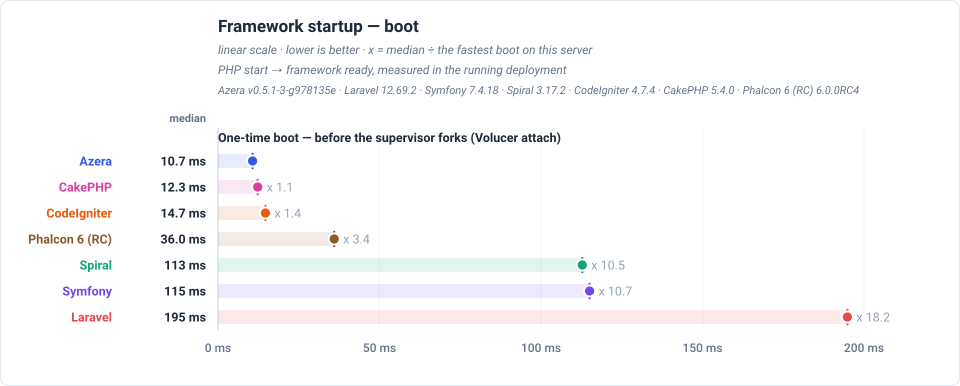

## Total response times

Total time to serve one pass over every benchmarked endpoint — each framework's sum of its endpoint medians, not a single response time — drawn relative to the baseline, so a row states how many times the baseline's own total it needed. Each endpoint's median is boot-inclusive occupancy for this view's deployment model, so the total is the worker time one pass over those endpoints costs. The chart orders the frameworks by that total and prints each one's multiplier beside its row.

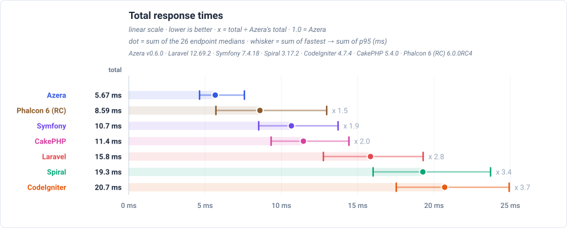

## Feature benchmarks

One race per framework feature, each run as a real request against a real database. Each feature states the request it measures under its own heading. Every figure — the winner of each race and the margin over the runner-up — is in that feature's own chart below, which anchors each endpoint at its fastest framework.

### Routing
 `GET /api/routing/1` — matches a typed route and dispatches it to a constant handler — no template and no database access — so the band measures route matching and dispatch and nothing else. The endpoint sits in a deep bucket of the route table, which is where a compiled index actually saves work. `/echo` is drawn beside it: the same constant handler behind a STATIC route, i.e. the floor that route matching is measured against — and, like any floor, it is mostly the SERVER rather than the framework. Measured 2026-11-24 with `temp/echo-ab.php` on the bench VM, the entire framework layer on `/echo` costs single-digit microseconds, inside rows that print two to three orders of magnitude more. A difference of a few microseconds there is below the run-to-run spread, so read `/echo` as the common floor and NOT as a comparison between entrants; the charts that separate frameworks are the ones with real work in them.

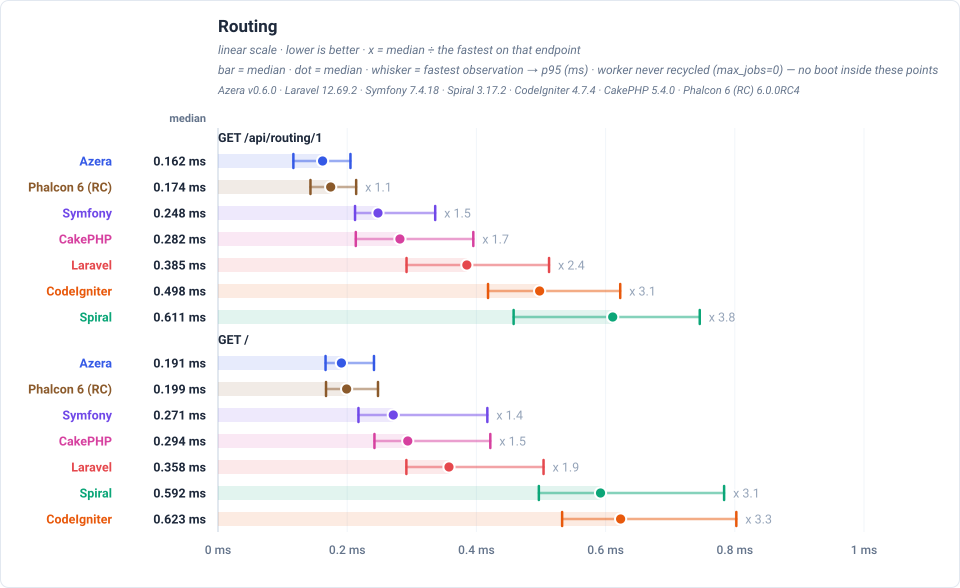

### ORM / Active Record
 `GET /items` — loads one page of the 1,000 seeded rows through each framework's ORM / Active Record layer: 20 items plus a COUNT for the pagination total. The `-fast` band repeats that page with hydration switched off, so the cost of building one object per row can be read directly instead of inferred.

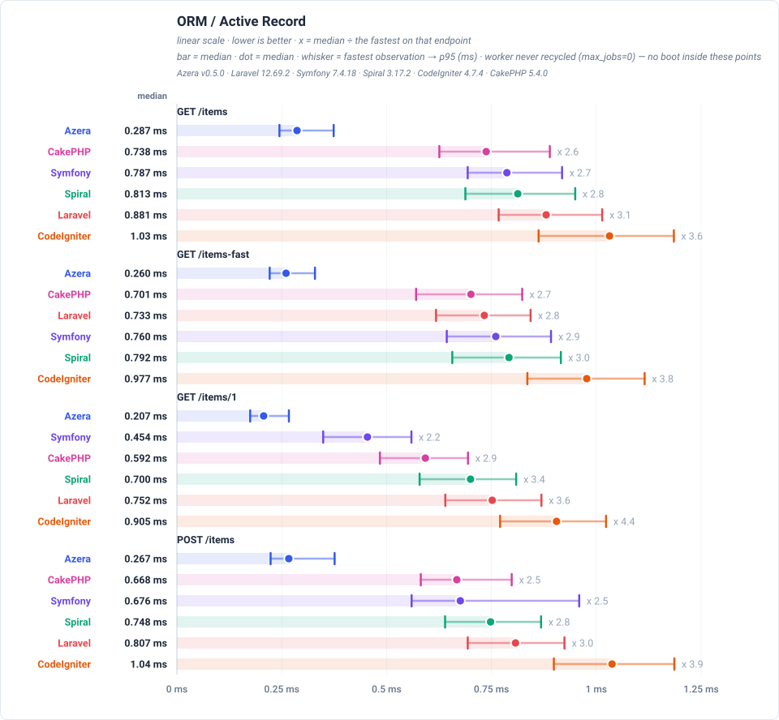

### Query Builder
 `GET /items-qb` — builds the same page of 20 items with each framework's query builder instead of its ORM, so the two data-access styles can be compared directly.

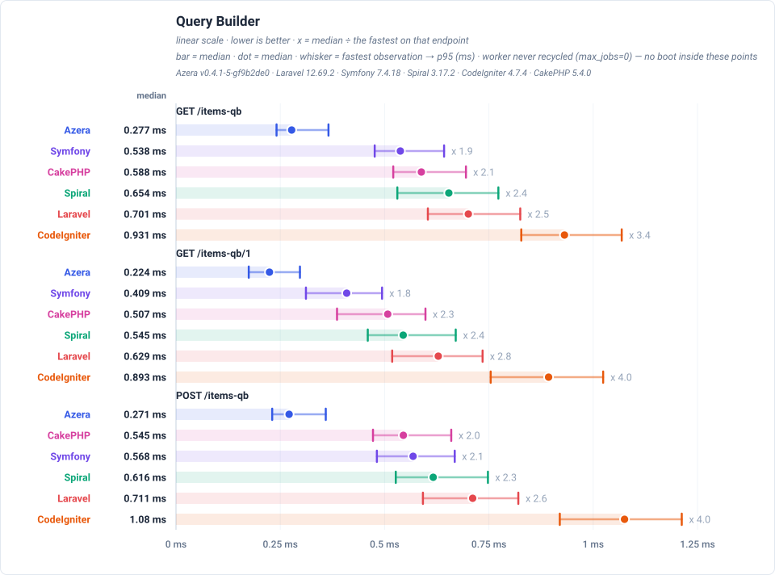

### REST API (JSON)
 `GET /api/items` — serves the same page of items as a JSON response rather than HTML, which adds serialization to the ORM work. The `-fast` band repeats that response with hydration switched off, so serialization cost and hydration cost can be told apart.

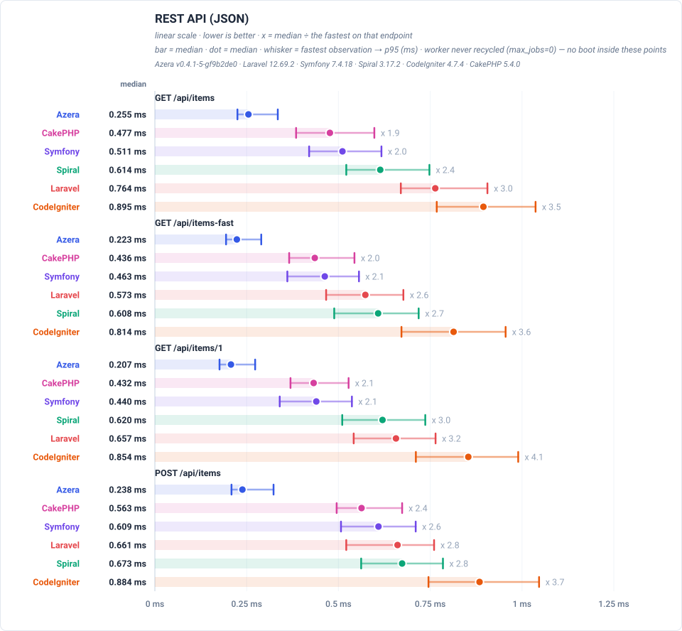

### Logging
 `GET /features/log` — logs a method entry and exit through the framework's own logger, and reports the records that logger captured. Every entrant uses the sink its own stack provides and every one of those sinks is in-process, so the row measures the logging path rather than disk or stderr I/O: Azera its PSR-3 `MemoryLogger`, Laravel `Log` → `LogManager` → Monolog's in-memory `TestHandler`, Symfony a PSR-3 logger registered as the `logger` service, Spiral `LogsInterface::getLogger()` feeding its `ListenerRegistry`, CakePHP `Log::write()` into an `ArrayLog` engine, CodeIgniter `log_message()` into a buffering handler, and Phalcon its own `Phalcon\Logger\Logger` with an in-memory adapter. NONE of them declares the logging as advice: Azera has `#[Log]`, but this row calls the logger directly so that all seven measure the same work — intercepting a logger would charge proxy cost to a chart about logging, which is what the `aop-*` rows exist to isolate. Phalcon's logger is not a PSR-3 implementation — it is the framework's own logger API — so the row demonstrates Phalcon logging, not interchangeable PSR-3 logging.

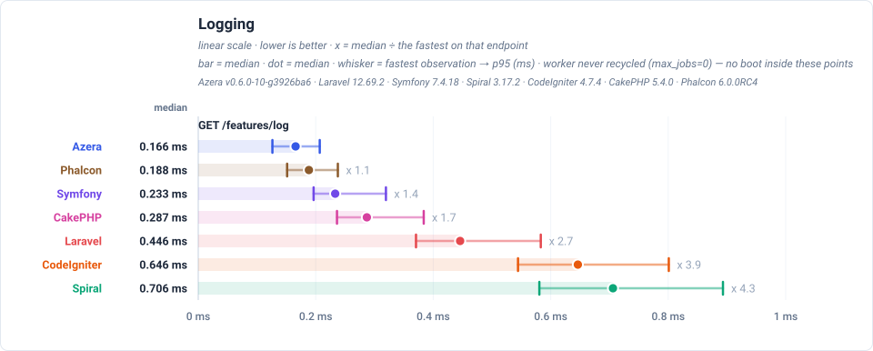

### Database Events
 `GET /features/db-events` — writes one row and reads one COUNT on an autocommit connection, so the framework's own database-observation hook can be read back: Azera's PSR-14 `DatabaseEvent` classes, Laravel's `DB::listen()`, the PSR-3 logger Doctrine DBAL and Cycle DBAL route through the driver, CodeIgniter's `DBQuery` event, CakePHP's driver query logger, and Phalcon's `db:` events manager. Every listener is attached once per process, so what the row prices is the hook, not its registration. Statements that describe the CONNECTION or the SCHEMA rather than the work — `PRAGMA` setup, `pragma_table_info`/`table_xinfo`/`index_list` reflection and `sqlite_master` lookups — are filtered out of the reported payload on every entrant, because whether a hook sees them depends on when it was attached relative to connection setup and how much introspection the ORM does per operation. Neither is the feature. All seven therefore report one entry per real statement: the upsert and the COUNT. Phalcon's `db:beginTransaction` / `db:commitTransaction` capability is real but is exercised by `/features/aop-tx-direct`, the control row that does open a transaction; wrapping this row's write in one charged it for something the feature is not about and reported two events no other entrant produces.

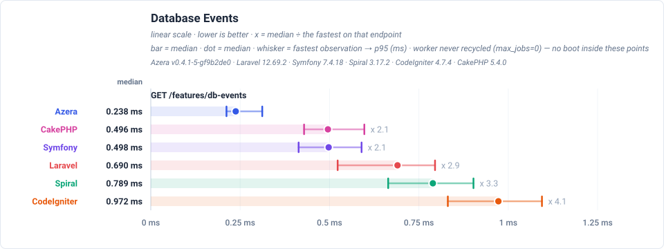

### Event Dispatcher
 `GET /features/events` — dispatches an in-process event to registered listeners. On Azera the item it writes goes through a generated `#[Transactional]` proxy, so this row includes interception cost the other entrants do not pay here.

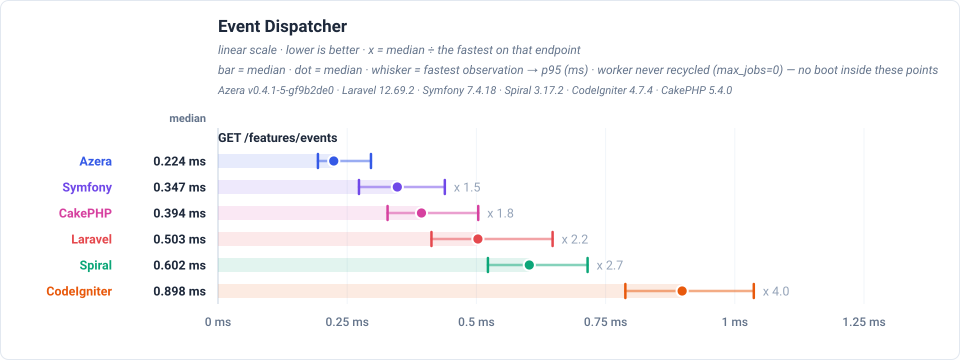

### Validation
 `GET /features/validation` — validates a payload with the framework's own validator.

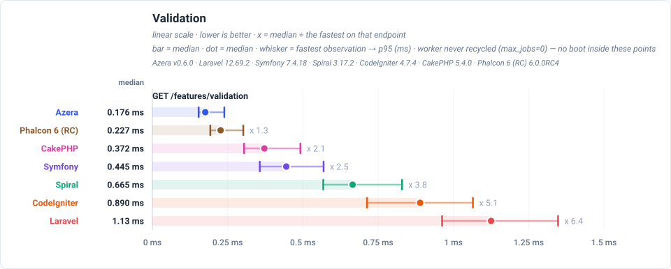

### Config
 `GET /features/config` — resolves a value from the framework's config repository.

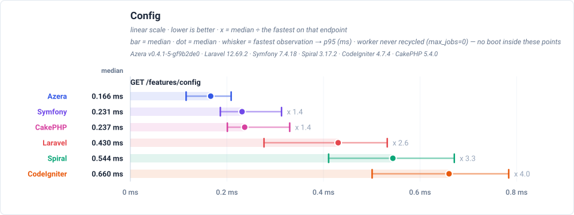

### Rate Limiter
 `GET /features/rate-limit` — checks a cache-backed rate limiter, which has long since denied the caller.

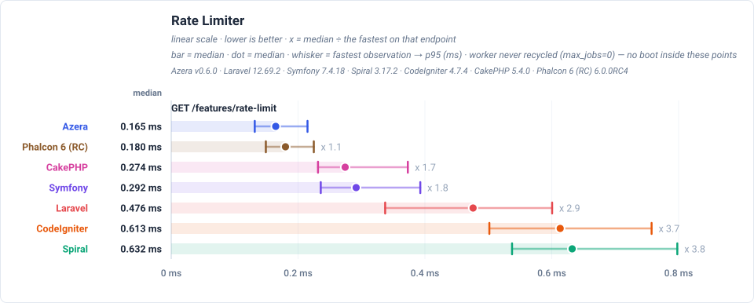

## Resident worker memory

Read from inside the live worker after each endpoint, on an extra untimed request that never touches the latency numbers. All six frameworks are drawn on one shared MB axis. The **left cap** is the PHP heap with the application booted and **no request served** — the framework's own data structures, with opcache bytecode excluded because it lives in shared memory. The **dot** is the heap after the last endpoint, and the **right cap** is the largest heap any endpoint reached. A narrow-left range that reaches far right is the shape worth watching: cheap to exist, expensive at its worst.

The numbers are read from the resident Volucer attach worker, which answers them directly in response headers.

Rows are ordered by the **dot** — the heap the worker was left holding after its last endpoint — so the table reads as one ranking from lightest steady state to heaviest. The multiplier beside a row divides its dot by the lightest dot on the page; the reference row carries none. A row can therefore sit high while having the lightest left cap: that is a framework that is cheap to boot and expensive to keep running, which is exactly the distinction the three marks exist to draw.

The dot and the right cap are both endpoint-order dependent — the probe reads the whole heap once per endpoint, so it cannot say what one request costs on its own — which is why they are drawn as a range and the dot marks the end of the run rather than a lighter reading. That caveat bounds what the numbers MEAN; it does not invalidate the comparison, because every row is read from the same single sequence of endpoints and therefore at the same moment. What it rules out is reading any one of them as a per-request cost. The distance from the left cap to the right one, and the number of steps over which the heap rises, are the growth a long-lived worker accumulates.

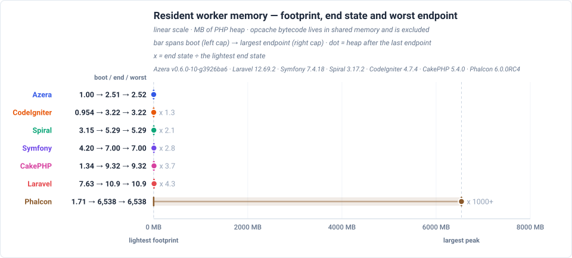

## Latency by endpoint

Median in milliseconds, lower is better. **Bold** = fastest for that endpoint; a trailing `≈` = within the run-to-run noise band of the fastest, so read it as a tie rather than a defeat (`Tables::TIE_BAND` states the band and how it was calibrated). The median is the statistic the charts beside this table draw, so a cell and its bar are the same number; the dataset also carries a trimmed mean, which sits a few percent higher and ranks identically in all but two dead-heat cells, and it stays available for the outlier-robust cross-check rather than as a second published figure. Every number is END-TO-END per-request occupancy for the view's deployment model: the framework boot of that model is part of the cell, not parked in a separate chart. These are REAL deployments measured over HTTP: every row carries the constant server cost, which is why the values cluster — the floor note below states what stands under them. The workload column states what each request reads or writes. Every framework runs the same seeded database and the same page size, so the payload is identical no matter which framework served it; the workload column is the part of the suite that varies.

These rows are end-to-end for a resident worker with a pool that never recycles it (one long-lived worker): the worker booted once before the first request and serves the whole run, so a cell is the measured request itself and carries no boot. The one-time recycle cost is measured in the startup chart — read that when sizing a pool that is recycled or restarted, or when requests queue behind one worker.

**Server floor** — a resident worker that boots NOTHING (`floor-volucer-attach`) measures this server's own overhead: a bare request round trip with no framework, no routing and no template, stated as that floor's `GET /echo` row in the dataset. Every row below stands on it, so only differences larger than it are framework differences — and a row BELOW it is a measurement that describes a different server than its floor, which is what FloorCoverageTest and bench-lib.php::assertRowsNotBelowFloor() now refuse.

**Run-to-run spread** — a resident arm's rows are mostly the server, so a cell moves by a few percent between two runs of unchanged code, and by more than a tenth on roughly one cell in five. Read a gap smaller than that band as a tie, which is what the trailing `≈` in the table marks, and prefer the rows where real work is done over the routing-only ones when the question is which framework is faster.

| Request | Workload | Azera | Laravel | Symfony | Spiral | CodeIgniter | CakePHP | Phalcon 6 (RC) |
|---|---|---:|---:|---:|---:|---:|---:|---:|
| `GET /api/routing/1` | no DB — typed route + constant body (routing only) | **0.162** | 0.385 | 0.248 | 0.611 | 0.498 | 0.282 | 0.174 |
| `GET /` | no DB — routing + template only | **0.191** | 0.358 | 0.271 | 0.592 | 0.623 | 0.294 | 0.199 |
| `GET /echo` | no DB — static route, constant body (throughput floor) | 0.171 | 0.300 | 0.235 | 0.634 | 0.490 | 0.232 | **0.149** |
| `GET /items` | 20 of 1000 items (page 1, + COUNT) | **0.329** | 0.937 | 0.833 | 0.921 | 1.02 | 0.769 | 0.623 |
| `GET /items-fast` | 20 of 1000 items (page 1, + COUNT), hydrated rows not built | **0.284** | 0.758 | 0.800 | 0.867 | 0.960 | 0.731 | 0.557 |
| `GET /items/1` | 1 item by id | **0.228** | 0.686 | 0.500 | 0.756 | 0.896 | 0.630 | 0.322 |
| `POST /items` | 1 row upserted (sentinel #999999) | **0.345** | 0.842 | 0.601 | 0.964 | 1.05 | 0.745 | 0.461 |
| `GET /items-qb` | 20 of 1000 items (page 1, + COUNT) | **0.277** | 0.707 | 0.518 | 0.774 | 0.954 | 0.534 | 0.307 |
| `GET /items-qb/1` | 1 item by id | **0.218** | 0.623 | 0.363 | 0.742 | 0.868 | 0.475 | 0.222≈ |
| `POST /items-qb` | 1 row upserted (sentinel #999997) | 0.286 | 0.674 | 0.432 | 0.807 | 1.07 | 0.601 | **0.256** |
| `GET /api/items` | 20 of 1000 items as JSON | **0.251** | 0.812 | 0.489 | 0.771 | 0.847 | 0.506 | 0.308 |
| `GET /api/items-fast` | 20 of 1000 items as JSON, rows not hydrated | **0.220** | 0.638 | 0.486 | 0.683 | 0.802 | 0.468 | 0.329 |
| `GET /api/items/1` | 1 item by id as JSON | **0.201** | 0.698 | 0.433 | 0.710 | 0.833 | 0.521 | 0.336 |
| `POST /api/items` | 1 row upserted (sentinel #999998) | **0.243** | 0.811 | 0.522 | 0.898 | 0.845 | 0.667 | 0.450 |
| `GET /features/aop-tx` | 1 row upserted (sentinel #888800) | — | — | — | — | — | — | — |
| `GET /features/aop-tx-direct` | 1 row upserted (sentinel #888800) | — | — | — | — | — | — | — |
| `GET /features/aop-tx-explicit` | 1 row upserted (sentinel #888800) | — | — | — | — | — | — | — |
| `GET /features/aop-cache` | COUNT(*) of 1000 rows, cached 10s by #[Cache] (miss = query) | — | — | — | — | — | — | — |
| `GET /features/aop-cache-direct` | COUNT(*) of 1000 rows, cached 10s by hand (miss = query) | — | — | — | — | — | — | — |
| `GET /features/log` | no DB — one in-memory log sink per entrant | **0.168** | 0.408 | 0.233 | 0.671 | 0.646 | 0.237 | 0.171≈ |
| `GET /features/db-events` | 1 row upserted (sentinel #888800) + COUNT(*), events collected | 0.249 | 0.690 | 0.558 | 0.927 | 0.990 | 0.594 | **0.234** |
| `GET /features/events` | no DB — in-process listeners | **0.229** | 0.603 | 0.359 | 0.760 | 0.905 | 0.486 | 1.79 |
| `GET /features/validation` | no DB — validator run | **0.176** | 1.13 | 0.445 | 0.665 | 0.890 | 0.372 | 0.227 |
| `GET /features/config` | no DB — config lookup | **0.164** | 0.422 | 0.248 | 0.672 | 0.579 | 0.241 | 0.181 |
| `GET /features/rate-limit` | no DB — cache-backed limiter | **0.165** | 0.476 | 0.292 | 0.632 | 0.613 | 0.274 | 0.180 |
| `GET /features/lifecycle-hooks` | no DB — a request/response hook stamps a header and sets 203, via each framework's own mechanism | — | — | — | — | — | — | — |

---

> **Auto-generated.** This page and its charts are produced by the `azera-competition` repository:
> `php run.php --apps=azera,laravel,symfony,spiral,codeigniter,cakephp --warm --cold --seed --out=results/free-for-all-opcache-iso`
> then `php scripts/derive-fpm.php results/free-for-all-opcache-iso` and `php scripts/report.php`. Do not edit by hand — re-run the benchmark to update it.

Every chart is a plain SVG generated from the result JSON, so the numbers and the diagrams can never disagree.
