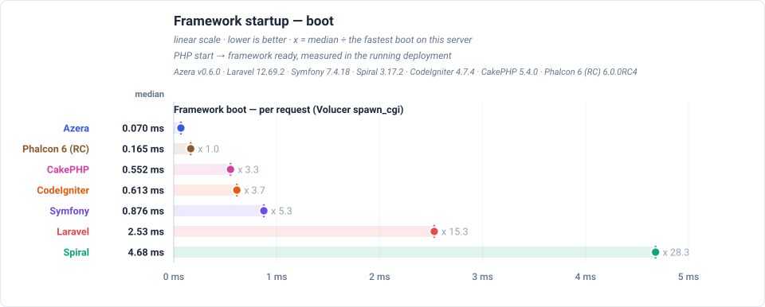
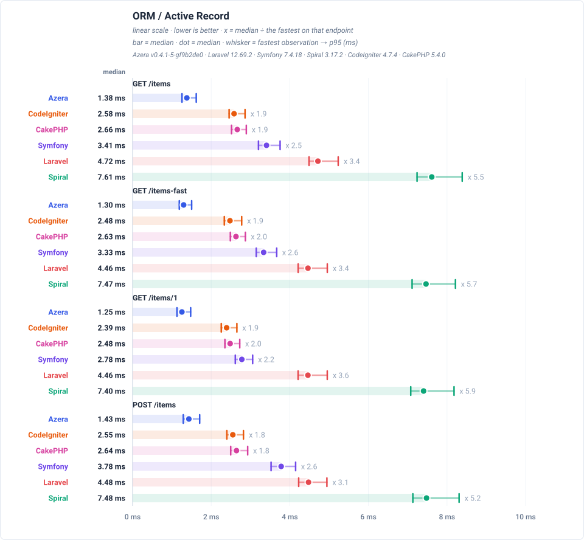
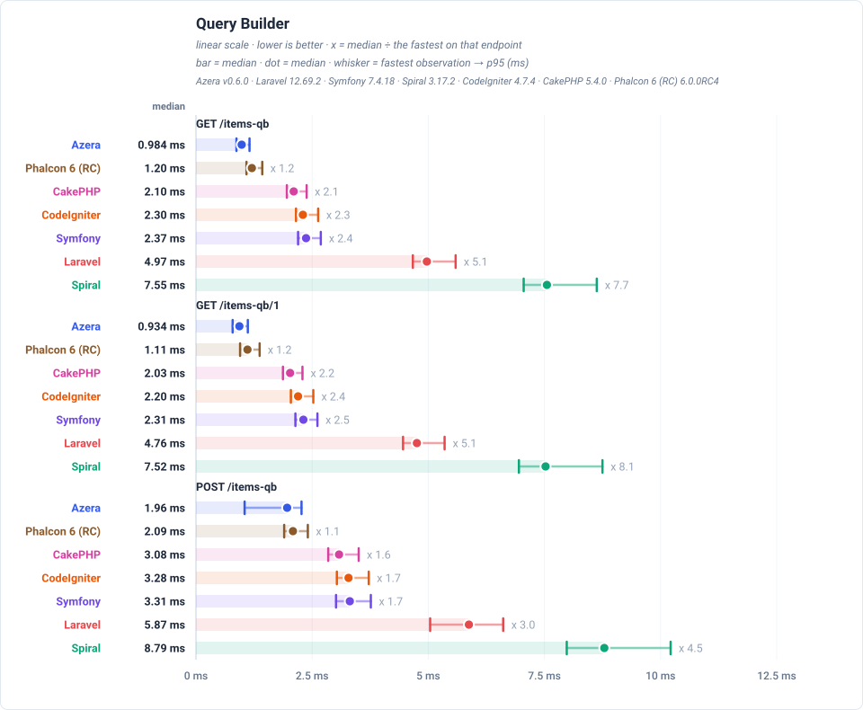
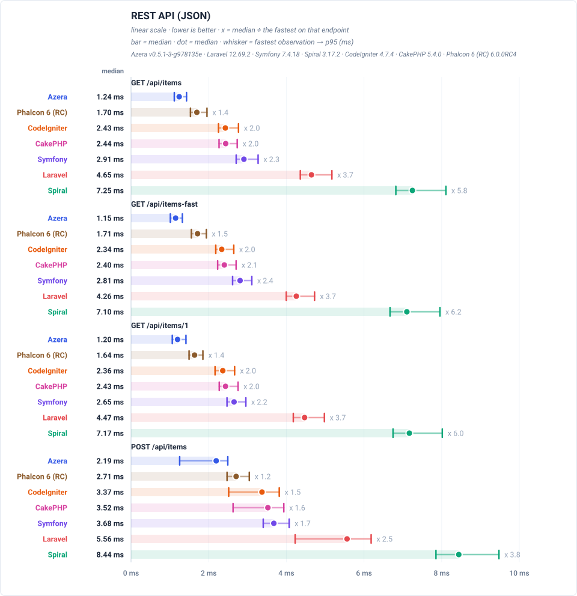
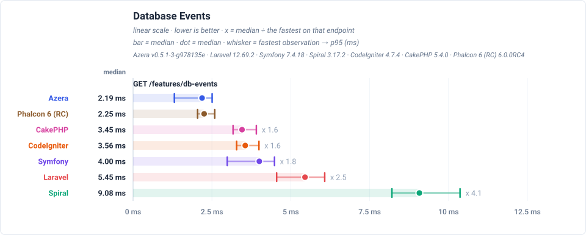
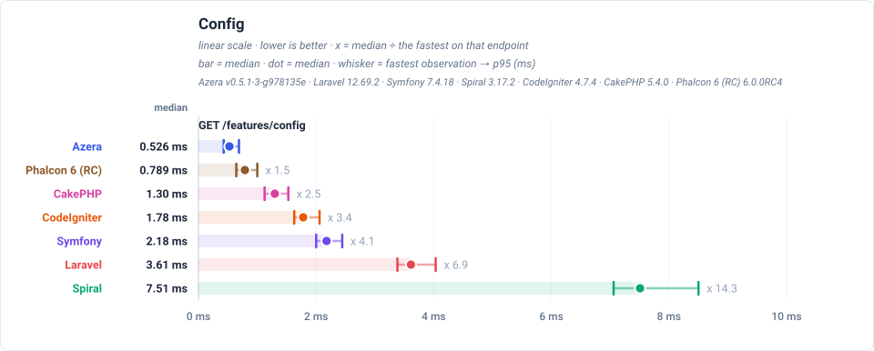

# Framework Competition — Volucer (spawn_cgi)

Volucer's `spawn_cgi` backend: volucer runs the app's entry script through a fresh `php-cgi` for every request, so the framework's boot is inside the request clock — the same shape as nginx + PHP-FPM, in a different server. The php-cgi pool is reached over a unix socket, not loopback TCP, so this arm differs from the FPM arm by its SERVER and never by its transport. End-to-end HTTP over loopback — includes the constant webserver overhead. Single sequential client.

**Environment** — PHP 8.5.11 · Linux 6.8.0-139-generic · JIT: tracing (buffer 64M) · 1000 iterations per run over 10 runs, lower is better.

**Frameworks** — Azera v0.4.1-5-gf9b2de0 · Laravel 12.69.2 · Symfony 7.4.18 · Spiral 3.17.2 · CodeIgniter 4.7.4 · CakePHP 5.4.0.

_Measured 2026-11-11T19:29:49+00:00_

## Framework startup

Time from PHP start until the framework is ready to serve, measured inside the Volucer spawn_cgi entry script — the boot every request waits for on this deployment, because Volucer spawn_cgi re-runs the entry script per request.

- The fastest and slowest framework on this band are named by the chart below; the multiplier beside each row states how many times the fastest boot it needed.
- Each framework's boot is reduced to one statistic (median of the probe samples), and the samples per framework are recorded in the dataset.

## Total response times

Total time to serve one pass over every benchmarked endpoint — each framework's sum of its endpoint medians, not a single response time — drawn relative to the baseline, so a row states how many times the baseline's own total it needed. Each endpoint's median is boot-inclusive occupancy for this view's deployment model, so the total is the worker time one pass over every endpoint costs. The chart orders the frameworks by that total and prints each one's multiplier beside its row.

## Feature benchmarks

One race per framework feature, each run as a real request against a real database. Each feature states the request it measures under its own heading. Every figure — the winner of each race and the margin over the runner-up — is in that feature's own chart below, which anchors each endpoint at its fastest framework.

### Routing
 `GET /` — dispatches a request through the router and returns a rendered template — no database access. The `/echo` band runs the same path with a constant handler instead, so what the template render costs can be read off directly rather than inferred.

### ORM / Active Record
 `GET /items` — loads one page of the 1,000 seeded rows through each framework's ORM / Active Record layer: 20 items plus a COUNT for the pagination total. The `-fast` band repeats that page with hydration switched off, so the cost of building one object per row can be read directly instead of inferred.

### Query Builder
 `GET /items-qb` — builds the same page of 20 items with each framework's query builder instead of its ORM, so the two data-access styles can be compared directly.

### REST API (JSON)
 `GET /api/items` — serves the same page of items as a JSON response rather than HTML, which adds serialization to the ORM work. The `-fast` band repeats that response with hydration switched off, so serialization cost and hydration cost can be told apart.

### AOP (Aspect-Oriented)
 `GET /features/aop` — runs a request through an interceptor pipeline — logging, retry and middleware aspects wrapped around the handler. Only frameworks with an AOP layer take part.

### Cache
 `GET /features/cache` — reads a COUNT(*) over the 1,000 rows through the framework's cache with a 10-second TTL, so a hit costs no database work and a miss runs the query.

### Database Events
 `GET /features/db-events` — inserts one event row per request and lets the framework's database events fire around that write.

### Event Dispatcher
 `GET /features/events` — dispatches an in-process event to registered listeners.

### Validation
 `GET /features/validation` — validates a payload with the framework's own validator.

### Config
 `GET /features/config` — resolves a value from the framework's config repository.

### Request-Scoped Services
 `GET /features/request-scoped` — resolves a service scoped to the request from the container.

### Rate Limiter
 `GET /features/rate-limit` — checks a cache-backed rate limiter.

## Latency by endpoint

Trimmed mean in milliseconds, lower is better. **Bold** = fastest for that endpoint. Every number is END-TO-END per-request occupancy for the view's deployment model: the framework boot of that model is part of the cell, not parked in a separate chart. These are REAL deployments measured over HTTP: every row carries the constant server cost, which is why the values cluster — the floor note below states what stands under them. The workload column states what each request reads or writes. Every framework runs the same seeded database and the same page size, so the payload is identical no matter which framework served it; the workload column is the part of the suite that varies.

**Server floor** — measured nginx + PHP-FPM with `pm.max_requests=0`: the pool never recycles its worker, so no process is spawned per request — what remains is the FastCGI handshake plus a minimal script. A hello-world endpoint that boots nothing but PHP (`floor-php`) and a static file through nginx (`floor-http`) measure exactly that cost — the floor every row below stands on. Subtracting that floor leaves the framework's own per-request boot, which FPM still pays for every request even though its worker survives.

| Request | Workload | Azera | Laravel | Symfony | Spiral | CodeIgniter | CakePHP |
|---|---|---:|---:|---:|---:|---:|---:|
| `GET /` | no DB — routing + template only | **0.649** | 3.69 | 1.89 | 6.68 | 1.81 | 1.38 |
| `GET /echo` | no DB — routing + dispatch only | **0.552** | 3.58 | 1.67 | 6.60 | 1.66 | 1.25 |
| `GET /items` | 20 of 1000 items (page 1, + COUNT) | **1.41** | 4.79 | 3.45 | 7.72 | 2.62 | 2.69 |
| `GET /items-fast` | 20 of 1000 items (page 1, + COUNT), hydrated rows not built | **1.32** | 4.52 | 3.38 | 7.56 | 2.51 | 2.66 |
| `GET /items/1` | 1 item by id | **1.28** | 4.52 | 2.81 | 7.51 | 2.42 | 2.51 |
| `POST /items` | 1 row upserted (sentinel #999999) | **1.47** | 4.56 | 3.82 | 7.61 | 2.60 | 2.68 |
| `GET /items-qb` | 20 of 1000 items (page 1, + COUNT) | **1.27** | 4.35 | 2.50 | 7.26 | 2.47 | 2.18 |
| `GET /items-qb/1` | 1 item by id | **1.20** | 4.23 | 2.44 | 7.16 | 2.39 | 2.07 |
| `POST /items-qb` | 1 row upserted (sentinel #999997) | **1.31** | 4.33 | 3.38 | 7.29 | 2.62 | 2.20 |
| `GET /api/items` | 20 of 1000 items as JSON | **1.27** | 4.68 | 2.79 | 6.84 | 2.46 | 2.41 |
| `GET /api/items-fast` | 20 of 1000 items as JSON, rows not hydrated | **1.18** | 4.27 | 2.74 | 6.69 | 2.36 | 2.36 |
| `GET /api/items/1` | 1 item by id as JSON | **1.20** | 4.52 | 2.60 | 6.73 | 2.37 | 2.42 |
| `POST /api/items` | 1 row upserted (sentinel #999998) | **1.27** | 4.41 | 3.61 | 6.81 | 2.47 | 2.56 |
| `GET /features/aop` | no DB — interceptor pipeline | **2.44** | 5.19 | 3.21 | 8.16 | — | — |
| `GET /features/cache` | COUNT(*) of 1000 rows, cached 10s (miss = query) | **1.48** | 4.46 | 2.80 | 7.38 | 2.32 | 2.30 |
| `GET /features/log` | no DB — buffered log handlers | **1.07** | 3.64 | 1.80 | 6.78 | — | — |
| `GET /features/retry` | no DB — retry policy | **1.05** | 3.65 | 1.81 | 6.89 | — | — |
| `GET /features/pipeline` | no DB — middleware pipeline | **0.606** | 3.64 | 1.78 | 7.03 | — | — |
| `GET /features/db-events` | 1 event row INSERTed per request | **1.56** | 4.41 | 2.96 | 7.81 | 2.58 | 2.50 |
| `GET /features/events` | no DB — in-process listeners | **1.52** | 4.12 | 2.29 | 7.45 | 2.49 | 1.87 |
| `GET /features/validation` | no DB — validator run | **0.597** | 4.57 | 2.13 | 6.93 | 2.11 | 1.70 |
| `GET /features/config` | no DB — config lookup | **0.548** | 3.62 | 1.80 | 6.81 | 1.78 | 1.29 |
| `GET /features/request-scoped` | no DB — scoped service resolve | **0.570** | 3.61 | 1.79 | 6.81 | 1.76 | 1.28 |
| `GET /features/rate-limit` | no DB — cache-backed limiter | **0.558** | 3.76 | 1.82 | 6.89 | 1.77 | 1.40 |

---

> **Auto-generated.** This page and its charts are produced by the `azera-competition` repository:
> `php run.php --apps=azera,laravel,symfony,spiral,codeigniter,cakephp --warm --cold --seed --out=results/free-for-all-opcache-iso`
> then `php scripts/derive-fpm.php results/free-for-all-opcache-iso` and `php scripts/report.php`. Do not edit by hand — re-run the benchmark to update it.

Every chart is a plain SVG generated from the result JSON, so the numbers and the diagrams can never disagree.
