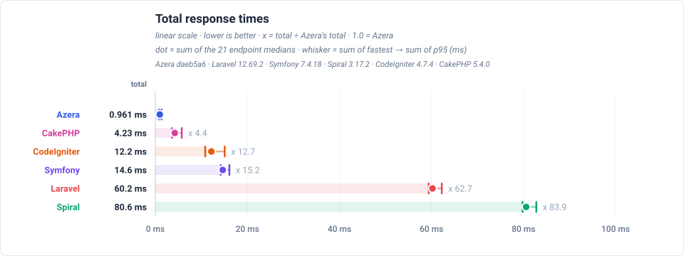
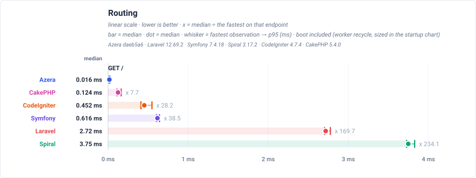
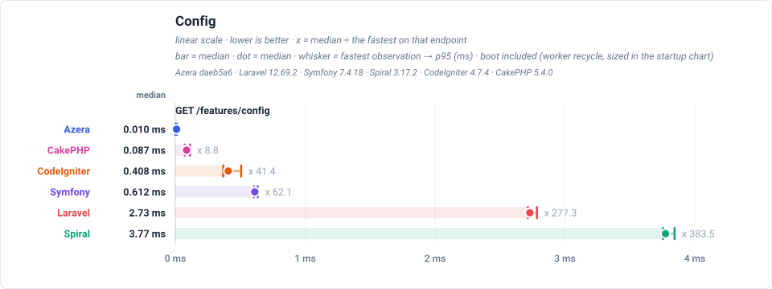
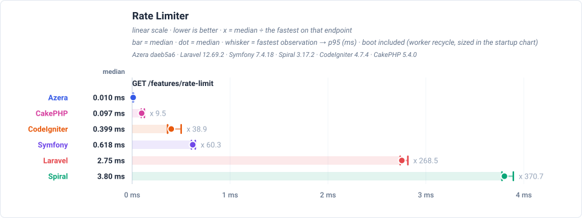

# Framework Competition — Warm Start

Resident-worker style (Octane / Volucer attach): the framework boots once, then serves every request. Each number charges that boot per request, so a cell is the whole time one request keeps a worker busy — what a recycled pool or a queue behind one worker actually experiences. Full-stack request lifecycle benchmark (routing → controller → ORM query (SQLite) → template render → response).

**Environment** — PHP 8.3.33 · Linux 6.8.0-139-generic · OPcache: yes · 1000 iterations per run over 30 runs, lower is better.

**Frameworks** — Azera daeb5a6 · Laravel 12.69.2 · Symfony 7.4.18 · Spiral 3.17.2 · CodeIgniter 4.7.4 · CakePHP 5.4.0.

_Measured 2026-09-20T14:28:59+00:00 · azera-framework `daeb5a6`_

## Framework startup

Three boot models, timed directly by the harness — each band shows boot + median teardown, because during both the worker cannot serve another request:

- **Cold boot** — the very first bootstrap in a fresh PHP process (autoloader + compile + FS cache): what a CLI run, CGI request, or newly spawned worker pays once. This is the most expensive band, and the chart's multiplier states by how much.
- **FPM rebuild** — a recycled PHP-FPM worker never pays the first band: sharing opcache bytecode with the master, it only rebuilds the application (container, routes, DB connect). The gap between the cold and FPM bands is the one-time compile cost shared bytecode removes.
- **Warm recycle** — worker restart with opcache warm: a re-bootstrap with every class already loaded. CodeIgniter's and CakePHP's re-bootstrap is a state reset there, not a kernel rebuild, so they read near zero.

Post-response teardown is the third term of each row's sub-line below — the work a worker does between requests (terminate() finalizers, request-scoped resets) and the smallest of the three terms in every row here.

## Total response times

Total time to serve one pass over every benchmarked endpoint — each framework's sum of its endpoint medians, not a single response time — drawn relative to the baseline, so a row states how many times the baseline's own total it needed. Each endpoint's median is boot-inclusive occupancy for this view's deployment model, so the total is the worker time one pass over those endpoints costs. The chart orders the frameworks by that total and prints each one's multiplier beside its row.

## Feature benchmarks

One race per framework feature, each run as a real request against a real database. Each feature states the request it measures under its own heading. Every figure — the winner of each race and the margin over the runner-up — is in that feature's own chart below, which anchors each endpoint at its fastest framework.

### Routing
 `GET /api/routing/1` — matches a typed route and dispatches it to a constant handler — no template and no database access — so the band measures route matching and dispatch and nothing else. The endpoint sits in a deep bucket of the route table, which is where a compiled index actually saves work. `/echo` is drawn beside it: the same constant handler behind a STATIC route, i.e. the floor that route matching is measured against — and, like any floor, it is mostly the SERVER rather than the framework. Measured 2026-11-24 with `temp/echo-ab.php` on the bench VM, the entire framework layer on `/echo` costs single-digit microseconds, inside rows that print two to three orders of magnitude more. A difference of a few microseconds there is below the run-to-run spread, so read `/echo` as the common floor and NOT as a comparison between entrants; the charts that separate frameworks are the ones with real work in them.

### ORM / Active Record
 `GET /items` — loads one page of the 1,000 seeded rows through each framework's ORM / Active Record layer: 20 items plus a COUNT for the pagination total. The `-fast` band repeats that page with hydration switched off, so the cost of building one object per row can be read directly instead of inferred.

### Query Builder
 `GET /items-qb` — builds the same page of 20 items with each framework's query builder instead of its ORM, so the two data-access styles can be compared directly.

### REST API (JSON)
 `GET /api/items` — serves the same page of items as a JSON response rather than HTML, which adds serialization to the ORM work. The `-fast` band repeats that response with hydration switched off, so serialization cost and hydration cost can be told apart.

### Logging
 `GET /features/log` — logs a method entry and exit through the framework's own logger, and reports the records that logger captured. Every entrant uses the sink its own stack provides and every one of those sinks is in-process, so the row measures the logging path rather than disk or stderr I/O: Azera its PSR-3 `MemoryLogger`, Laravel `Log` → `LogManager` → Monolog's in-memory `TestHandler`, Symfony a PSR-3 logger registered as the `logger` service, Spiral `LogsInterface::getLogger()` feeding its `ListenerRegistry`, CakePHP `Log::write()` into an `ArrayLog` engine, CodeIgniter `log_message()` into a buffering handler, and Phalcon its own `Phalcon\Logger\Logger` with an in-memory adapter. NONE of them declares the logging as advice: Azera has `#[Log]`, but this row calls the logger directly so that all seven measure the same work — intercepting a logger would charge proxy cost to a chart about logging, which is what the `aop-*` rows exist to isolate. Phalcon's logger is not a PSR-3 implementation — it is the framework's own logger API — so the row demonstrates Phalcon logging, not interchangeable PSR-3 logging.

### Database Events
 `GET /features/db-events` — writes one row and reads one COUNT on an autocommit connection, so the framework's own database-observation hook can be read back: Azera's PSR-14 `DatabaseEvent` classes, Laravel's `DB::listen()`, the PSR-3 logger Doctrine DBAL and Cycle DBAL route through the driver, CodeIgniter's `DBQuery` event, CakePHP's driver query logger, and Phalcon's `db:` events manager. Every listener is attached once per process, so what the row prices is the hook, not its registration. Statements that describe the CONNECTION or the SCHEMA rather than the work — `PRAGMA` setup, `pragma_table_info`/`table_xinfo`/`index_list` reflection and `sqlite_master` lookups — are filtered out of the reported payload on every entrant, because whether a hook sees them depends on when it was attached relative to connection setup and how much introspection the ORM does per operation. Neither is the feature. All seven therefore report one entry per real statement: the upsert and the COUNT. Phalcon's `db:beginTransaction` / `db:commitTransaction` capability is real but is exercised by `/features/aop-tx-direct`, the control row that does open a transaction; wrapping this row's write in one charged it for something the feature is not about and reported two events no other entrant produces.

### Event Dispatcher
 `GET /features/events` — dispatches an in-process event to registered listeners. On Azera the item it writes goes through a generated `#[Transactional]` proxy, so this row includes interception cost the other entrants do not pay here.

### Validation
 `GET /features/validation` — validates a payload with the framework's own validator.

### Config
 `GET /features/config` — resolves a value from the framework's config repository.

### Rate Limiter
 `GET /features/rate-limit` — checks a cache-backed rate limiter, which has long since denied the caller.

## Peak memory

Peak memory reached on any endpoint, in MB. Each row is one framework: the **bar** and the **dot** are its median endpoint, the **whisker** spans its lightest to its heaviest endpoint, and the multiplier beside the row states how many times the lightest framework's median it needed.

## Latency by endpoint

Median in milliseconds, lower is better. **Bold** = fastest for that endpoint; a trailing `≈` = within the run-to-run noise band of the fastest, so read it as a tie rather than a defeat (`Tables::TIE_BAND` states the band and how it was calibrated). The median is the statistic the charts beside this table draw, so a cell and its bar are the same number; the dataset also carries a trimmed mean, which sits a few percent higher and ranks identically in all but two dead-heat cells, and it stays available for the outlier-robust cross-check rather than as a second published figure. Every number is END-TO-END per-request occupancy for the view's deployment model: the framework boot of that model is part of the cell, not parked in a separate chart. The workload column states what each request reads or writes. Every framework runs the same seeded database and the same page size, so the payload is identical no matter which framework served it; the workload column is the part of the suite that varies.

Each cell also shows the request's lifecycle split as `total boot + handle + cleanup` — the terms sum to the headline. Cleanup is the post-response teardown a worker performs between requests (terminate() finalizers, request-scoped resets); handle is the dispatch itself; boot is the framework startup that request waits for in this deployment model.

These rows are end-to-end for a resident worker: every headline and every chart point adds the worker's boot (warm recycle, measured in the startup chart) to the measured request, so a cell is the time one request keeps that worker busy — the number to read when workers are recycled per request or requests queue behind one pool. This dataset does not record the pool's max_jobs, so the boot is charged per request.

| Request | Workload | Azera | Laravel | Symfony | Spiral | CodeIgniter | CakePHP |
|---|---|---:|---:|---:|---:|---:|---:|
| `GET /api/routing/1` | no DB — typed route + constant body (routing only) | — | — | — | — | — | — |
| `GET /` | no DB — routing + template only | **0.016 0.001+0.014+0.001** | 2.72 2.51+0.21+0.00 | 0.616 0.529+0.085+0.002 | 3.75 3.47+0.27+0.01 | 0.452 0.000+0.443+0.009 | 0.124 0.006+0.117+0.001 |
| `GET /echo` | no DB — static route, constant body (throughput floor) | — | — | — | — | — | — |
| `GET /items` | 20 of 1000 items (page 1, + COUNT) | **0.135 0.001+0.131+0.003** | 3.23 2.49+0.74+0.00 | 1.05 0.52+0.53+0.00 | 4.01 3.46+0.53+0.02 | 0.740 0.000+0.728+0.012 | 0.456 0.006+0.449+0.001 |
| `GET /items-fast` | 20 of 1000 items (page 1, + COUNT), hydrated rows not built | — | — | — | — | — | — |
| `GET /items/1` | 1 item by id | **0.050 0.001+0.047+0.002** | 2.89 2.50+0.39+0.00 | 0.691 0.524+0.165+0.002 | 3.84 3.47+0.36+0.01 | 0.644 0.000+0.632+0.012 | 0.294 0.006+0.287+0.001 |
| `POST /items` | 1 row upserted (sentinel #999999) | **0.103 0.001+0.100+0.002** | 2.91 2.50+0.41+0.00 | 0.776 0.520+0.253+0.003 | 3.89 3.47+0.41+0.01 | 0.712 0.000+0.700+0.012 | 0.402 0.006+0.395+0.001 |
| `GET /items-qb` | 20 of 1000 items (page 1, + COUNT) | **0.089 0.001+0.087+0.001** | 2.92 2.50+0.42+0.00 | 0.759 0.522+0.235+0.002 | 3.84 3.47+0.36+0.01 | 0.725 0.000+0.713+0.012 | 0.263 0.006+0.256+0.001 |
| `GET /items-qb/1` | 1 item by id | **0.049 0.001+0.047+0.001** | 2.81 2.50+0.31+0.00 | 0.661 0.525+0.134+0.002 | 3.80 3.47+0.32+0.01 | 0.636 0.000+0.624+0.012 | 0.208 0.006+0.201+0.001 |
| `POST /items-qb` | 1 row upserted (sentinel #999997) | **0.080 0.001+0.078+0.001** | 2.90 2.50+0.40+0.00 | 0.793 0.519+0.271+0.003 | 3.83 3.47+0.35+0.01 | 0.824 0.000+0.811+0.013 | 0.275 0.006+0.268+0.001 |
| `GET /api/items` | 20 of 1000 items as JSON | **0.038 0.001+0.036+0.001** | 3.11 2.50+0.61+0.00 | 0.753 0.524+0.227+0.002 | 3.88 3.47+0.40+0.01 | 0.590 0.000+0.580+0.010 | 0.247 0.006+0.240+0.001 |
| `GET /api/items-fast` | 20 of 1000 items as JSON, rows not hydrated | — | — | — | — | — | — |
| `GET /api/items/1` | 1 item by id as JSON | **0.037 0.001+0.035+0.001** | 2.90 2.50+0.40+0.00 | 0.669 0.524+0.143+0.002 | 3.80 3.47+0.32+0.01 | 0.559 0.000+0.548+0.011 | 0.217 0.006+0.210+0.001 |
| `POST /api/items` | 1 row upserted (sentinel #999998) | **0.053 0.001+0.050+0.002** | 2.85 2.50+0.35+0.00 | 0.760 0.522+0.236+0.002 | 3.84 3.47+0.36+0.01 | 0.629 0.000+0.618+0.011 | 0.303 0.006+0.296+0.001 |
| `GET /features/aop-tx` | 1 row upserted (sentinel #888800) | — | — | — | — | — | — |
| `GET /features/aop-tx-direct` | 1 row upserted (sentinel #888800) | — | — | — | — | — | — |
| `GET /features/aop-tx-explicit` | 1 row upserted (sentinel #888800) | — | — | — | — | — | — |
| `GET /features/aop-cache` | COUNT(*) of 1000 rows, cached 10s by #[Cache] (miss = query) | — | — | — | — | — | — |
| `GET /features/aop-cache-direct` | COUNT(*) of 1000 rows, cached 10s by hand (miss = query) | — | — | — | — | — | — |
| `GET /features/log` | no DB — one in-memory log sink per entrant | **0.013 0.001+0.011+0.001** | 2.72 2.50+0.22+0.00 | 0.610 0.529+0.079+0.002 | 3.78 3.47+0.30+0.01 | 0.389 0.000+0.381+0.008 | 0.088 0.006+0.081+0.001 |
| `GET /features/db-events` | 1 row upserted (sentinel #888800) + COUNT(*), events collected | **0.046 0.001+0.044+0.001** | 2.89 2.50+0.39+0.00 | 0.726 0.524+0.200+0.002 | 3.95 3.46+0.48+0.01 | 0.718 0.000+0.706+0.012 | 0.242 0.006+0.235+0.001 |
| `GET /features/events` | no DB — in-process listeners | **0.038 0.001+0.036+0.001** | 2.80 2.50+0.30+0.00 | 0.641 0.525+0.114+0.002 | 3.83 3.46+0.36+0.01 | 0.679 0.000+0.667+0.012 | 0.138 0.006+0.131+0.001 |
| `GET /features/validation` | no DB — validator run | **0.019 0.001+0.017+0.001** | 3.33 2.48+0.85+0.00 | 0.719 0.524+0.193+0.002 | 3.81 3.47+0.33+0.01 | 0.662 0.000+0.649+0.013 | 0.175 0.006+0.168+0.001 |
| `GET /features/config` | no DB — config lookup | **0.010 0.001+0.008+0.001** | 2.73 2.51+0.22+0.00 | 0.612 0.529+0.081+0.002 | 3.77 3.46+0.30+0.01 | 0.408 0.000+0.400+0.008 | 0.087 0.006+0.080+0.001 |
| `GET /features/rate-limit` | no DB — cache-backed limiter | **0.010 0.001+0.008+0.001** | 2.75 2.50+0.25+0.00 | 0.618 0.528+0.088+0.002 | 3.80 3.46+0.33+0.01 | 0.399 0.000+0.391+0.008 | 0.097 0.006+0.090+0.001 |
| `GET /features/lifecycle-hooks` | no DB — a request/response hook stamps a header and sets 203, via each framework's own mechanism | — | — | — | — | — | — |

---

> **Auto-generated.** This page and its charts are produced by the `azera-competition` repository:
> `php run.php --apps=azera,laravel,symfony,spiral,codeigniter,cakephp --warm --cold --seed --out=results/free-for-all-opcache-iso`
> then `php scripts/derive-fpm.php results/free-for-all-opcache-iso` and `php scripts/report.php`. Do not edit by hand — re-run the benchmark to update it.

Every chart is a plain SVG generated from the result JSON, so the numbers and the diagrams can never disagree.
